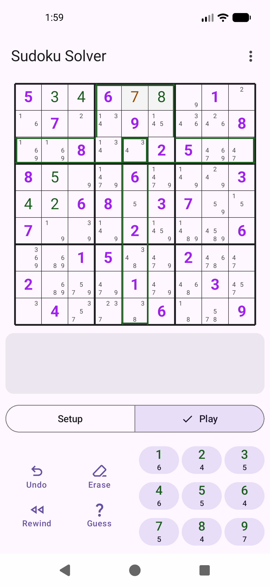
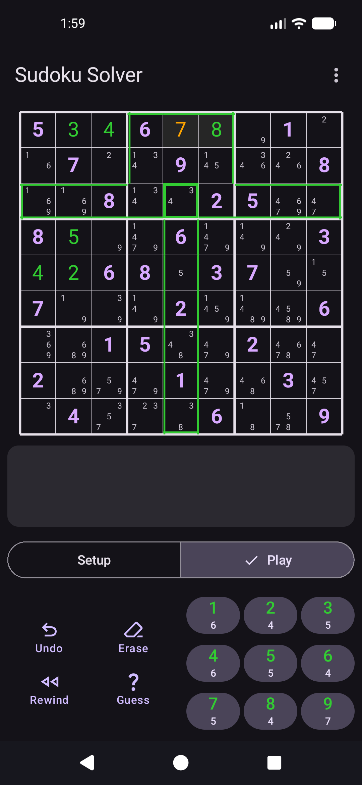

# Sudoku Solver for Android

Play sudoku puzzles on an Android phone.  The app plays the very same game as the
terminal version (see the [top-level README](../README.md)): the game is the repository's
Python code, run inside the app, and the screen is native Android, written in Kotlin with
Jetpack Compose.  It shows each cell's possible values and highlights conflicts as you
play, and keeps the game you are playing until you come back to it.

  
  &nbsp;&nbsp;
  

This is MVP 1: setting up and playing a puzzle from start to finish.  The solving help of
the terminal version (`n`, `a`, `w`, tags and "must be" marks) comes in MVP 2, and a list
of saved games, shared with the PC, in MVP 3.

## Installing it on a phone

The app isn't on the Play Store.  Each version is a GitHub Release with the app attached:
1. On the phone, open the [Releases](https://github.com/aivanov61/sudoku-solver/releases)
   page and download `app-release.apk` from the latest release.
1. Open the downloaded file.  Android asks you to let the browser (or Files app) "Install
   unknown apps": allow it, for that app only.  Installing an app from outside the Play
   Store this way is called sideloading.
1. Play Protect may warn that it doesn't know the app; choose to install it anyway.

It needs Android 7.0 or later.  A later release installs over the earlier one and keeps
the game in progress, as every release is signed with the same key.  The first start
after installing takes several seconds, while the app unpacks Python.

## Playing

First you will see the GNU GPL notice, which goes away after 5 seconds or with a tap.
Then the game you were playing comes back, or else a new puzzle starts in setup (with a
choice of layouts first, should there ever be more than one).

The screen has, from the top: the top app bar with its menu (⋮), the board, a message
area for hints and warnings, the Setup | Play switch, and the controls: the commands on
the left (Undo, Erase, Rewind and Guess) and the digit pad on the right.  When the phone
is turned sideways, the controls move beside the board.

- **Setting up:** tap a cell, then a digit, to enter each of the puzzle's given numbers,
  shown in purple.  When all the givens are in, tap Play.
- **Playing:** tap a cell, then a digit.  The small number under each digit on the pad is
  how many of that digit are still to place; the small digits in an empty cell are the
  values it can still take.
- **Guessing:** tap Guess before a digit.  Guesses, and everything entered after them,
  are shaded, deeper for each guess made on top of another, and Rewind goes back to just
  before the most recent guess.
- **Mistakes:** a value that clashes with another in its row, column or box is shown on
  yellow.  Undo takes back the last value entered, and Erase clears a cell.

The menu has:
- **New puzzle:** which ends the game in play (asking first) and starts another
- **How to play:** which says the same as above, but with slightly more detail
- **About:** which shows the version and the GNU GPL Copyright license

There is no Quit: leave the app with Back or Home, and it saves the game for when you return,
even if Android closes it in the meantime.

## Building it

### Requirements

1. [Android Studio](https://developer.android.com/studio), recent enough for Android
   Gradle plugin 9.5.  It brings the Android SDK and the Java runtime the build uses.
1. Python 3.15 on the PC, as `py -3.15` (Windows) or `python3.15`.  Chaquopy, which puts
   Python into the app, uses it to compile the game.
1. To try the app on a phone, the phone with USB debugging on (Developer options);
   otherwise an emulator, which Android Studio's Device Manager makes.

### Building and running

Open this `android/` folder (not the repository's top level) in Android Studio, let it
sync, and run the `app` configuration.  This builds the debug app and installs it on the
emulator or the connected phone.  The debug app is called "Sudoku Solver (debug)" and
installs beside the release, each with its own game.

Each build first copies the repository's own Python (`../game` and `../ui/android`,
without their tests) into the app, so the app always plays the same code as the
terminal.  Change the game there, never in the copy under `app/build/`.

From a terminal, in this folder (on Windows, with `JAVA_HOME` set to Android Studio's
`jbr` folder):
- `.\gradlew.bat :app:installDebug` builds the debug app and installs it
- `.\gradlew.bat :app:assembleRelease` builds the release, in `app/build/outputs/apk/release/`

The release is shrunk by R8, and signed with the release key when it is given one; without
it, the release is built unsigned.  How the key is given to the build, with its password
never on disk, is in [docs/architecture.md](docs/architecture.md#building-and-installing).

## Testing

- `.\gradlew.bat :app:testDebugUnitTest` runs the unit tests (`app/src/test`), on the PC.
  They cover the ViewModels, the repositories and the app's container, with fakes in place
  of the game, so Python doesn't run in them.
- `.\gradlew.bat :app:createDebugUnitTestCoverageReport` runs them and shows which lines
  they never run, in `app/build/reports/coverage/test/debug/index.html`
- `.\gradlew.bat :app:connectedDebugAndroidTest` runs the Compose UI tests
  (`app/src/androidTest`) on the emulator or phone: they show the screens, tap them as a
  player would, and check what the screens ask for.  They take a few minutes, and
  uninstall the debug app afterwards, with its saved game.
- The Python side of the app, `../ui/android/`, is tested with the rest of the Python code
  (see the top-level README).

## The code

The app follows Google's [guide to app architecture](https://developer.android.com/topic/architecture):
a UI layer of Compose screens and their ViewModels, over a data layer of repositories, with
the Python game as the one source of truth for the puzzle.  [CLAUDE.md](CLAUDE.md) records
how the app was planned and built, phase by phase.

### File layout

- app/build.gradle.kts - how the app is built: its build types, signing, and the tasks that copy in the Python game and the copyright notice
- app/src/main/java/io/github/aivanov61/sudoku/
  - SudokuApplication.kt - made once per process; makes the app's container
  - AppContainer.kt - makes the repositories and the game, for the ViewModels (dependency injection by hand)
  - MainActivity.kt - hosts the screens, and navigates between them with Navigation 3
  - game/ - the game as the app sees it, the only code that knows Python (through Chaquopy)
    - Game.kt, GameEvent.kt - what the game reports and what it is asked to do
    - PythonGame.kt - runs the Python game on its own thread
    - PythonScreen.kt - receives the game's reports from Python, as `GameEvent`s
    - PythonLayoutRepository.kt, PythonSavedGameRepository.kt - the layouts, and the saved game's layout
  - data/ - the repositories, each the one way to its data
    - GameRepository.kt, GameState.kt - the game in play, and what it last reported
    - LayoutRepository.kt, SavedGameRepository.kt, CopyrightRepository.kt - the layouts, the saved game, the GNU GPL notice
  - ui/ - the screens and their ViewModels
    - SudokuScreen.kt, SudokuViewModel.kt, SudokuUiState.kt, GameTopBar.kt - the game
    - SplashScreen.kt, LayoutPickerScreen.kt, HowToPlayScreen.kt, AboutScreen.kt - the other screens, each beside its ViewModel, if it has one
    - Keys.kt - the routes the app navigates between
    - theme/ - the light and dark themes, and the game's colors, as the terminal's
- app/src/main/res/ - the app's text (`values/strings.xml`), icons and themes
- app/src/test/ - the unit tests, beside fakes of what they replace
- app/src/androidTest/ - the Compose UI tests
- ../ui/android/ - the Python side: the game's user interface port, passing each call on to Kotlin
- docs/architecture.md - the app's architecture, as diagrams

### Class Organization

See [docs/architecture.md](docs/architecture.md), the app's design doc, which draws all the
classes and how they work together: an overview, then each feature (the splash, the layouts,
the game, How to play and About) through the layers, with a sequence diagram for each.  The
game itself, which the app runs unchanged, is described in the top-level
[DesignDoc.md](../DesignDoc.md).
