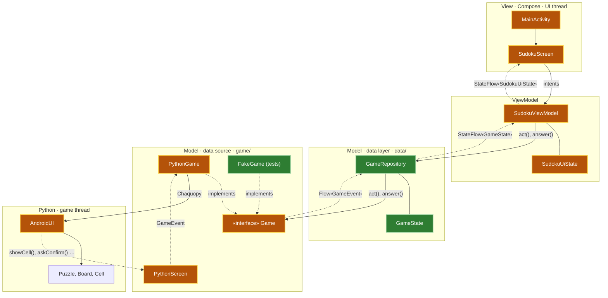
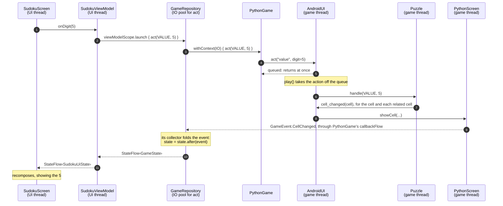

# The Android app's architecture

How the app's code maps onto MVVM and Modern Android App Architecture, and how the parts talk to each other.
Updated at the end of each phase; this is the state after **MVP 1, phase 1** (the data layer).

Colors: green is new in phase 1, amber is changed in phase 1, uncolored is unchanged.

Arrows: solid arrows are calls; dotted arrows are data flowing back, or a class implementing an interface.

## The layers

Everything from `GameRepository` down is MVVM's **Model**, which Google's guide splits into the data layer and
its data sources. The Python game is at the bottom, as the source of truth for the puzzle.

| Layer | Class | What it does |
|---|---|---|
| View | `MainActivity` | Makes the ViewModel, collects its `uiState` with `collectAsStateWithLifecycle()`, and shows `SudokuScreen`; closes once the game is over |
| View | `SudokuScreen` | Stateless composables: draws the state, and passes taps on as intents (`SudokuIntents`) |
| ViewModel | `SudokuViewModel` | `uiState = repository.state.map { SudokuUiState(it) }.stateIn(viewModelScope, WhileSubscribed(5 s))`; each intent is `viewModelScope.launch { repository.act(...) }` |
| ViewModel | `SudokuUiState` | The game's state, plus what the screen works out from it (the mode switch) |
| Data layer | `GameRepository` | The one way to the game, in an app-long scope: `state = events.runningFold(GameState()) { s, e -> s.after(e) }.stateIn(scope, Eagerly)`; `act()` and `answer()` run on `Dispatchers.IO` |
| Data layer | `GameState` | Only what the game reported; `after(event)` works out each event's effect |
| Data source | `Game` | The interface: `events: Flow<GameEvent>`, `act()`, `answer()` |
| Data source | `PythonGame` | The real game: `events = callbackFlow { ... }` starts the game thread; `act()` calls `AndroidUI.act()` through Chaquopy |
| Data source | `PythonScreen` | What Python calls (`showCell()`, `askConfirm()`, `questionAnswered()`, ...), turned into `GameEvent`s |
| Data source | `FakeGame` | A stand-in for tests: reports the events it is given, records the actions |
| Python | `AndroidUI` | The port's adapter (`ui/android/`): `act()` → actions queue → `play()` → `puzzle.handle()`; `confirm()` waits for `answer()` |
| Python | `Puzzle`, `Board`, `Cell`, ... | The game itself (`game/`): the single source of truth for the puzzle |

## One tap, end to end: entering 5 in the selected cell

The intent and the result travel separate paths: `act()` returns as soon as the action is queued, and the 5
comes back later as events (unidirectional data flow). The UI thread never waits on Python.
