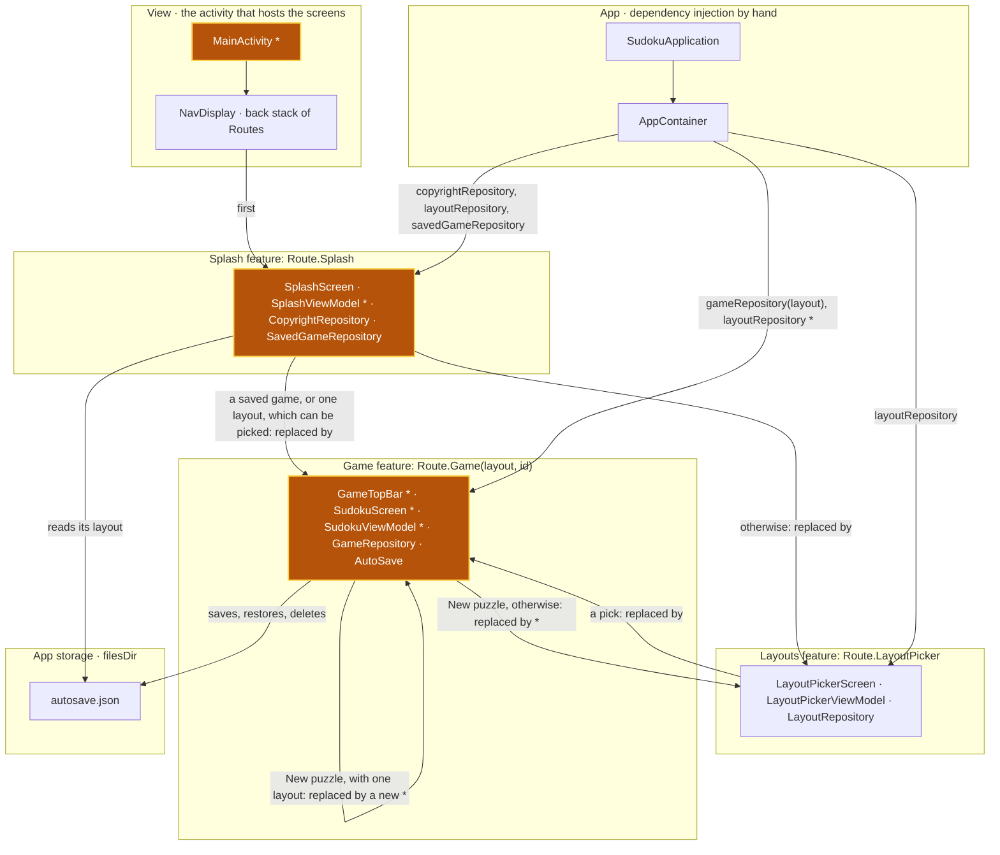
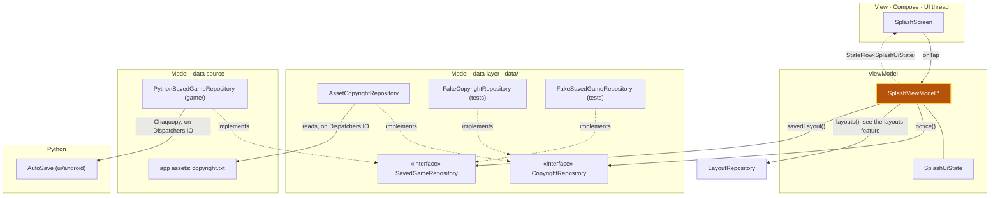
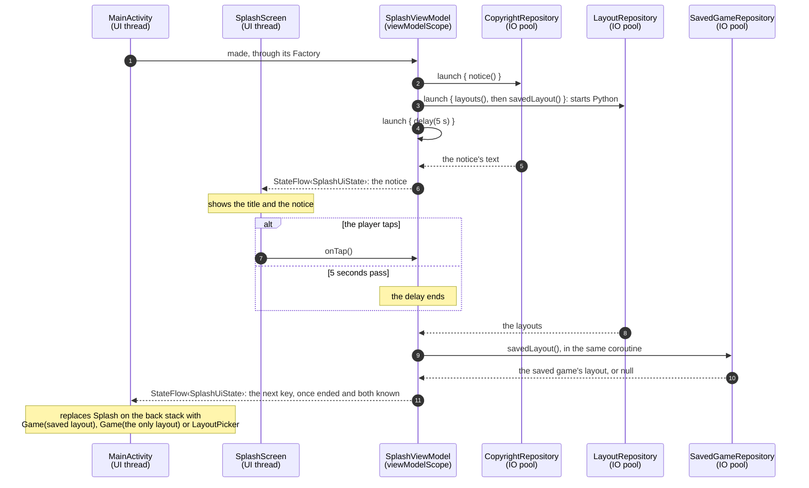
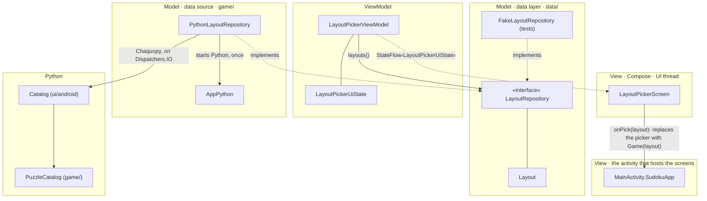
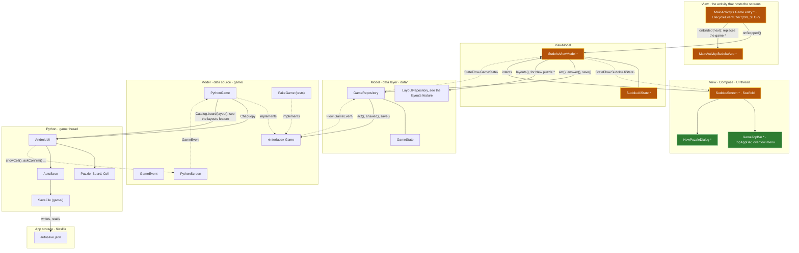
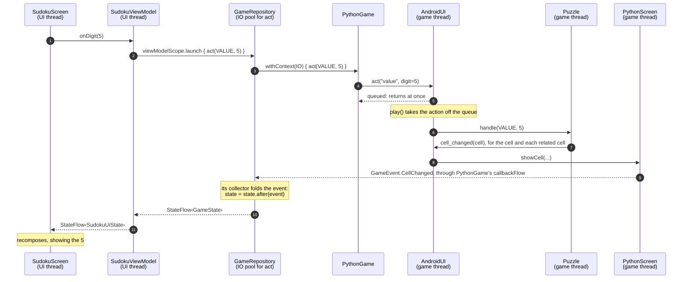
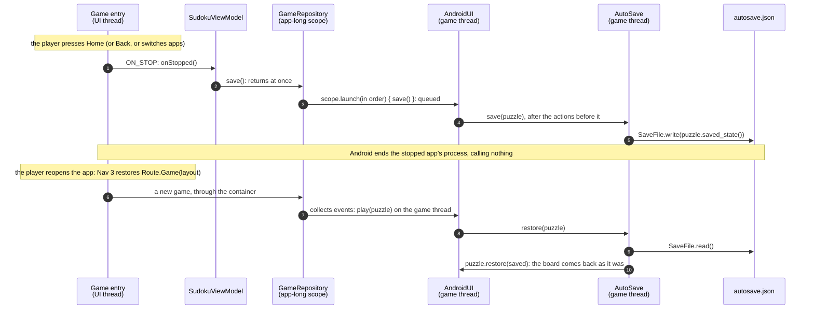
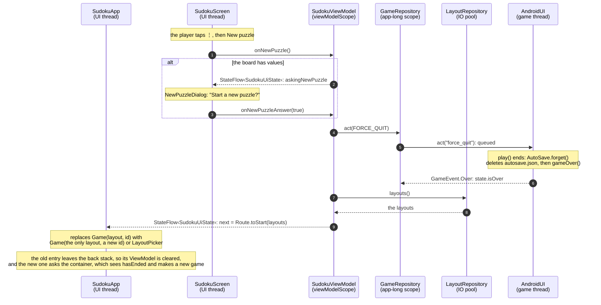
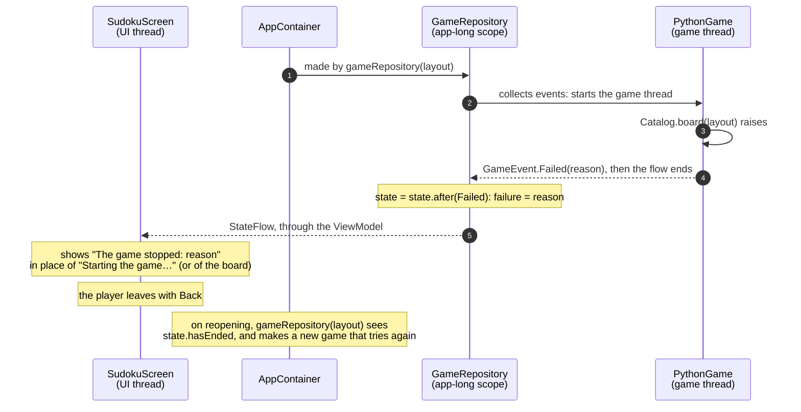

# The Android app's architecture

How the app's code maps onto MVVM and Modern Android App Architecture, and how the parts talk to each other.
Updated at the start of each phase and as it goes; this is **MVP 1, phase 6** (top app bar and menus).

Phase 6 gives the game screen a Material 3 top app bar, with the app-level menu behind its overflow button (⋮).
The menu has one item for now, New puzzle; Settings and About join it later.

New puzzle asks first when the board has values, since they would be lost. It then ends the game in play (the
game's own `FORCE_QUIT`, after which `AndroidUI` deletes the auto-save), and the game screen is replaced by the
route that starts a game, as after the splash: the layout picker when there are several layouts, else a new game
on the only one.

The Quit button goes, as MVP 1 plans (Android apps are left with Back or Home), so a game is now over only when the
player starts a new puzzle, and the app no longer closes itself.

The app is drawn as an overview, then one section per feature (a screen with its ViewModel and data), each
through the same layers. Features share only the app's container and the activity that hosts their screens.

Colors: green is new in phase 6, amber is changed in phase 6, uncolored is unchanged.

Marks: * marks what phase 6 adds or changes but hasn't written yet; each comes off as its part gets written.

Arrows: solid arrows are calls; dotted arrows are data flowing back, or a class implementing an interface.

## Overview

| Class | What it does |
|---|---|
| `SudokuApplication` | Made by Android once per process, before any screen (the manifest names it); makes the one `AppContainer`, giving it `newGame` (a `PythonGame` on the layout named), `newLayoutRepository`, `newCopyrightRepository` and `newSavedGameRepository`. It names the auto-save file, `filesDir/autosave.json`, and gives it to both the game and the saved game's repository |
| `AppContainer` | The app's dependencies (`DefaultAppContainer`): the app-long scope; `gameRepository(layout)`, the game in play, made when first asked for and anew for another layout or once the game has ended (over, or failed: `GameState.hasEnded`, so reopening the app tries again); and the `LayoutRepository`, `CopyrightRepository` and `SavedGameRepository`, each made when first asked for |
| `MainActivity` | Its composable `SudokuApp` holds the back stack (`rememberNavBackStack(Route.Splash)`, kept through rotation and process death) and shows it with `NavDisplay`; `rememberViewModelStoreNavEntryDecorator()` gives each entry its own ViewModels, which live as long as its route is on the stack. Each entry is a small composable (`Splash`, `LayoutPicker`, `Game`) that gets its ViewModel and shows its screen. `SudokuApp` does the navigating (`replaceLast`): it replaces the splash with the splash's `next` route once there is one, the picker with `Route.Game(layout)` when the player picks one, and \*the game with the game's `next` route once the player has started a new puzzle (it no longer closes the app). The game's entry has the game saved whenever the app is stopped (`LifecycleEventEffect(ON_STOP)`) |
| `Route` | `ui/Keys.kt`: Navigation 3's keys, one per screen, in a sealed interface (so `Route.Game` doesn't clash with the `Game` interface): `Route.Splash`, `Route.LayoutPicker` and `Route.Game(layout, id)`, each a `@Serializable` `NavKey`. Each step replaces the route before it, so Back from the picker or the game leaves the app. After process death the stack comes back as it was, so the app reopens on `Route.Game` without the splash, and the game restores itself from the auto-save. \*`id` is new in phase 6: Nav 3 tells entries apart by their keys, so a new game on the same layout needs a key of its own, or Nav 3 would keep the old entry, and with it the ViewModel of the game that has ended; each `Route.Game` is made with a fresh `id`, which is saved with the back stack. \*`Route.toStart(layouts, savedLayout)` is the route that starts a game, worked out once for the splash and for New puzzle: the game on the saved layout, else on the only layout, when it can be picked, else the picker |
| `autosave.json` | The game in progress, in app-specific internal storage (`filesDir`: no permission needed, private to the app, deleted on uninstall). It is an ordinary save file, written and read only by the game (`game/save_file.py`), so it is interchangeable with the PC's |

### Where the app's state lives

| Where | Survives | Holds |
|---|---|---|
| \*The composition (`remember`) | recomposition; not rotation | \*the overflow menu's open state, UI element state with no logic behind it |
| ViewModel | rotation | each screen's UI state, \*including whether New puzzle is asking |
| Saved instance state (the Nav 3 back stack) | rotation and process death; not Back, or a swipe from Recents | the `Route`s |
| App storage (`filesDir`) | everything, until the app is uninstalled | the game in progress, `autosave.json` |

Android may end a stopped app's process at any time, without calling it, so the game is saved when the app is
stopped (`ON_STOP`): on Home, Back, a switch to another app, and a rotation.

## The splash feature

The notice's one copy is the repository's `ui/copyright.txt`: the build packages it as an asset
(`syncSharedAssets`), and the terminal reads it too.

| Layer | Class | What it does |
|---|---|---|
| View | `SplashScreen` | Stateless: the title at the top, the notice centred in the space below (a `Column` with a weighted `Box`); the whole screen reports a tap with `onTap` |
| ViewModel | `SplashViewModel` | Reads the notice from the `CopyrightRepository` and starts a 5-second timer, both in `viewModelScope`; `onTap()` ends the splash at once; its state lives in a `MutableStateFlow`; its `Factory` gets the repositories from the app's container. It also reads the layouts (which starts Python behind the splash) and the saved game's layout, and once the splash has ended and both are known, gives the route that replaces it: \*`Route.toStart(layouts, savedLayout)` (see `Route`), which it shares with the game screen's New puzzle: `Route.Game(layout)` for the saved game's layout when it can be picked, else for the only layout when there is exactly one and it can be picked, as the terminal plays it, otherwise `Route.LayoutPicker` |
| ViewModel | `SplashUiState` | The notice (empty until read), and `next`, the route that replaces the splash, null until the splash has ended and the layouts and the saved game are known |
| Data layer | `CopyrightRepository` | The interface: the one way to the GNU GPL notice, `suspend fun notice(): String` |
| Data layer | `AssetCopyrightRepository` | The real one: reads `copyright.txt` from the app's assets on `Dispatchers.IO`, and reflows it (`String.reflow()`): the file breaks its lines for the terminal, so each paragraph's lines are joined, for the screen to wrap to its own width |
| Data layer | `FakeCopyrightRepository` | A true fake for tests: returns the text it was given |
| Data layer | `SavedGameRepository` | The interface: the one way to what the auto-save holds before a game is started, `suspend fun savedLayout(): String?`, the name of the layout it is on, or null when there is none, or it can't be read (the game says why when it starts) |
| Data layer | `FakeSavedGameRepository` | A true fake for tests: returns the layout it was given |
| Data source | `PythonSavedGameRepository` | The real one: asks the Python `AutoSave` for the layout of the auto-save file, through Chaquopy, on `Dispatchers.IO` |
| Data source | app assets | `copyright.txt`, packaged from the repository's `ui/copyright.txt` by the build |
| Python | `AutoSave` | `ui/android/auto_save.py` (see the game feature): `saved_layout()` reads the file through `SaveFile` |

### From start through splash to game

Python starts behind the splash: reading the layouts starts it, and its slow first start overlaps the 5 seconds.
The layouts and the saved game are read one after the other, in one coroutine, as both go through the one
Python. If the splash is tapped before they are known, it waits for them. The splash's ViewModel
lives only while `Splash` is on the back stack, so its timer ends with it.

## The layouts feature

| Layer | Class | What it does |
|---|---|---|
| View | `LayoutPickerScreen` | Stateless: a Material 3 list of the layouts (`ListItem`s), each with its label; a broken one is shown, with its notes, but can't be picked. When none can be picked, it says so above the list, so the notes explain why; Back leaves the app. A pick goes up as `onPick(layout)`, which `SudokuApp` handles: picking is navigation, so it is the UI's to do, not the ViewModel's |
| ViewModel | `LayoutPickerViewModel` | Reads the layouts for the picker, in `viewModelScope`; its `Factory` gets the repository from the app's container |
| ViewModel | `LayoutPickerUiState` | The layouts (null until read), and `noneCanBePicked`: they are known and none can be picked, so the screen says so |
| Data layer | `Layout` | One layout: its `name`, its `label` (the name and any notes, as the terminal shows it), and whether it `canPick` |
| Data layer | `LayoutRepository` | The interface: the one way to the puzzle layouts, `suspend fun layouts(): List<Layout>` |
| Data layer | `FakeLayoutRepository` | A true fake for tests: returns the layouts it was given; a test can hold them back until it releases them, as a slow first start of Python would |
| Data source | `PythonLayoutRepository` | The real one: asks the Python `Catalog` for the layouts, through Chaquopy, on `Dispatchers.IO` |
| Data source | `AppPython` | Starts the app's one Python on first use, synchronized, for the layouts, the saved game and the game; slow the first time after an install |
| Python | `Catalog` | `ui/android/catalog.py`: lists the layouts in plain values, and makes the board of the one named; it plays the part `Main` plays for the terminal |
| Python | `PuzzleCatalog` | The game's catalog (`game/`): finds the layouts in `game/puzzles/` |

## The game feature

Everything from `GameRepository` down is MVVM's **Model**, which Google's guide splits into the data layer and
its data sources. The Python game is at the bottom, as the source of truth for the puzzle.

| Layer | Class | What it does |
|---|---|---|
| View | `MainActivity`'s `Game` entry | Gets the ViewModel and shows the screen; calls `onStopped()` whenever the app is stopped, with `LifecycleEventEffect(Lifecycle.Event.ON_STOP)`, which runs only while the entry is on screen. \*Once the state has a `next` route, it gives it to `onEnded`, as the splash's entry does, and `SudokuApp` replaces the game with it; it no longer closes the app |
| View | `SudokuScreen` | Stateless composables: draws the state, and passes taps on as intents (`SudokuIntents`); when the game has failed, shows why ("The game stopped: …") in place of the board, or of "Starting the game…". \*Now in a Material 3 `Scaffold`, which places the top app bar and pads the content clear of it and of the system bars (in place of `safeDrawingPadding()`); \*the Quit button goes |
| View | `GameTopBar` | \*New: a Material 3 `TopAppBar`, titled "Sudoku", whose one action is the overflow button (⋮, a Material Symbols vector drawable in `res/drawable`) opening a `DropdownMenu` with New puzzle, enabled once the game has started or failed. Whether the menu is open is kept in the composable (`remember`), as Google's guide on state hoisting allows for UI element state with no logic behind it; it closes on a rotation, as menus do |
| View | `NewPuzzleDialog` | \*New: an `AlertDialog`, "Start a new puzzle? The one in progress will be lost.", with Start new and Cancel; shown while `SudokuUiState.askingNewPuzzle` |
| ViewModel | `SudokuViewModel` | `uiState` combines `repository.state` with the screen's own state (\*whether New puzzle is asking, and the `next` route) into `SudokuUiState`, `.stateIn(viewModelScope, WhileSubscribed(5 s))`; each intent is `viewModelScope.launch { repository.act(...) }`; `onStopped()` asks the repository to save the game; `factory(layout)` gets the game on that layout, \*and the layouts' repository, from the app's container. \*`onNewPuzzle()` asks first when the board has values, else goes on at once; once the player goes on (`onNewPuzzleAnswer(true)`), it ends the game with `FORCE_QUIT` (unless the game has failed, when it has already ended), reads the layouts, waits for the game to end, and sets `next` to `Route.toStart(layouts)`: with the auto-save gone, that is the picker, or a new game on the only layout |
| ViewModel | `SudokuUiState` | The game's state, plus what the screen works out from it: the mode switch, \*`canStartNew` (the game has started or failed), `askingNewPuzzle`, and `next`, the route that replaces the game, null until a new puzzle has been asked for and the game has ended |
| ViewModel | `SudokuIntents` | What the player can do on the screen: \*`onNewPuzzle()` and `onNewPuzzleAnswer(yes)` are new, \*`onQuit()` goes |
| Data source | `GameAction` | `GameNames.kt`: the game's actions the app uses; \*`FORCE_QUIT` (stop at once, without the game's own "Really quit?") takes the place of `QUIT` |
| Data layer | `GameRepository` | The one way to the game, in an app-long scope: `state = events.runningFold(GameState()) { s, e -> s.after(e) }.stateIn(scope, Eagerly)`; `act()` and `answer()` run on `Dispatchers.IO`, one at a time, so they keep their order. `save()` doesn't wait: it launches the save in the app-long scope, on the same one-at-a-time dispatcher, so it isn't canceled when Back clears the ViewModel right after `ON_STOP`, and it comes after the actions already made |
| Data layer | `GameState` | Only what the game reported; `after(event)` works out each event's effect; including `GameEvent.Failed`, which sets `failure`, the reason the game stopped. `failure` is kept apart from `isOver`, since `isOver` closes the app and the player would never see why; `hasEnded` is either |
| Data source | `Game` | The interface: `events: Flow<GameEvent>`, `act()`, `answer()`, `save()` |
| Data source | `GameEvent` | What the game reports (`Started`, `CellChanged`, `Over`, ...), and `Failed(reason)`: the game has stopped on an error, while starting or later, and its flow ends |
| Data source | `PythonGame` | The real game, on the layout named, auto-saved to the file it is given: `events = callbackFlow { ... }` starts the game thread, on the board from `Catalog.board(layout)` (with Python started by `AppPython`), and ends when the game is over; `act()` and `save()` call `AndroidUI` through Chaquopy. Any error that reaches it, in setting up or in play, is reported as `GameEvent.Failed`, so the app never waits on a game that can't start or no longer answers (an error in one of the player's actions doesn't reach it: `AndroidUI` catches that, and play goes on) |
| Data source | `PythonScreen` | What Python calls (`showCell()`, `askConfirm()`, `questionAnswered()`, ...), turned into `GameEvent`s |
| Data source | `FakeGame` | A stand-in for tests: reports the events it is given, records the actions and the saves |
| Python | `AndroidUI` | The port's adapter (`ui/android/`): `act()` and `save()` → one requests queue → `play()`, so a save never lands in the middle of a move; an action goes to `puzzle.handle()`, a save to `AutoSave`. `play()` has `AutoSave` restore the game first, and forget it once the game is over; `confirm()` waits for `answer()`. \*Unchanged in phase 6, but New puzzle now relies on a `force_quit` action ending play and deleting the auto-save, so a test says so |
| Python | `AutoSave` | `ui/android/auto_save.py`: the game in progress, in the file it is given, read and written through `SaveFile`. `restore()` restores the file's puzzle into the game, or warns why it can't (damaged, from a newer version, or on another layout) and leaves the file alone; `save()` writes the game when the board has values; `forget()` deletes the file once the game is over. A file it couldn't read is overwritten only once the player has something to save, and is never deleted, so the player can still install a newer version or keep the file |
| Python | `SaveFile` | The game's save files (`game/save_file.py`), the same format as on the PC |
| Python | `Puzzle`, `Board`, `Cell`, ... | The game itself (`game/`): the single source of truth for the puzzle; `saved_state()` and `restore()` |

### One tap, end to end: entering 5 in the selected cell

The intent and the result travel separate paths: `act()` returns as soon as the action is queued, and the 5
comes back later as events (unidirectional data flow). The UI thread never waits on Python.

### Leaving the app, and coming back after process death

A fresh start of the app goes through the splash instead, which reads the saved game's layout and opens
`Route.Game` on it; from there the game restores itself the same way.

### \*New puzzle, from the menu

Cancel (`onNewPuzzleAnswer(false)`), or a tap outside the dialog, leaves the game as it was. When the game has
failed, New puzzle goes straight to the next route, as there is nothing left to lose or to end.

### When the game fails

For example, after process death the back stack reopens `Route.Game(layout)`, but that layout has since been
removed from `game/puzzles/`, or broken. Any other error that reaches `PythonGame`, while starting or later, goes
the same way.

The cases, side by side:

| What happens | `GameState` | What the player sees |
|---|---|---|
| Python is still starting | `size` null, `failure` null | "Starting the game…" |
| An action fails (`AndroidUI` catches it, as the terminal does) | `message`, a warning | The board, with the warning in the status line; play goes on |
| The auto-save can't be restored (damaged, from a newer version, or on another layout) | `message`, a warning | A new board, with the warning in the status line; the file is kept until the player has something to save |
| Anything else fails, while starting or later (`PythonGame` catches it) | `failure` set | "The game stopped: …" in place of the board; \*New puzzle starts again; Back leaves; reopening tries again |
| \*The player starts a new puzzle | `isOver` | The auto-save is deleted, then the layout picker, or a new game on the only layout |
