# The Android app's architecture

How the app's code maps onto MVVM and Modern Android App Architecture, and how the parts talk to each other.
Updated at the start of each phase and as it goes; this is **MVP 1, step 10c** (pushing screens onto the back
stack; Up versus Back).

Step 10c adds two screens to the game's menu, How to play and About (see
[How to play and About](#how-to-play-and-about)).

- **Pushed, not replaced.** Until now, each screen replaced the one before it, so the back stack held one route.
  How to play and About are pushed on top of the game, and popped off again, so the game is still there below
  them, as it was.

- **Up and Back.** Each has a top app bar with Up (←), which pops it, as Back does: within an app, Up and Back
  lead to the same place ([Principles of navigation](https://developer.android.com/guide/navigation/principles)).

- **About** shows the app's version and the GNU GPL notice, read through the splash's `CopyrightRepository`.

The app is drawn as an overview, then one section per feature (a screen with its ViewModel and data), each
through the same layers. Features share only the app's container and the activity that hosts their screens.

Colors: green is new in step 10c, amber is changed in step 10c, uncolored is unchanged. A `*` marks a part not
written yet. The diagrams step 10c doesn't change are as step 10b left them, with its colors taken off.

Arrows: solid arrows are calls; dotted arrows are data flowing back, or a class implementing an interface.

## Overview

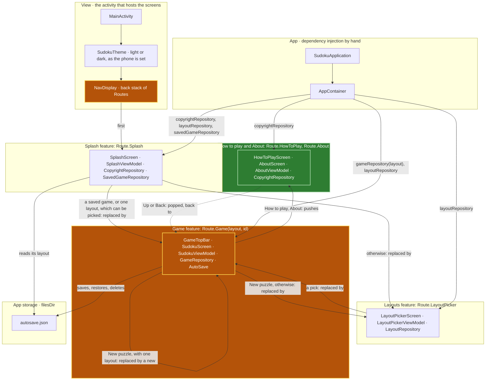

| Class | What it does |
|---|---|
| `SudokuApplication` | Made by Android once per process, before any screen (the manifest names it); makes the one `AppContainer`, giving it `newGame` (a `PythonGame` on the layout named), `newLayoutRepository`, `newCopyrightRepository` and `newSavedGameRepository`. It names the auto-save file, `filesDir/autosave.json`, and gives it to both the game and the saved game's repository. It gives the game the number of `GuessShades`, joining the screen's choice to the game's warning, as wiring is the app's to do |
| `AppContainer` | The app's dependencies (`DefaultAppContainer`): the app-long scope; `gameRepository(layout)`, the game in play, made when first asked for and anew for another layout or once the game has ended (over, or failed: `GameState.hasEnded`, so reopening the app tries again); and the `LayoutRepository`, `CopyrightRepository` and `SavedGameRepository`, each made when first asked for |
| `MainActivity` | Shows everything in `SudokuTheme`. Its composable `SudokuApp` holds the back stack (`rememberNavBackStack(Route.Splash)`, kept through rotation and process death) and shows it with `NavDisplay`; `rememberViewModelStoreNavEntryDecorator()` gives each entry its own ViewModels, which live as long as its route is on the stack. Each entry is a small composable (`Splash`, `LayoutPicker`, `Game`) that gets its ViewModel and shows its screen. `SudokuApp` does the navigating (`replaceLast`): it replaces the splash with the splash's `next` route once there is one, the picker with `Route.Game(layout)` when the player picks one, and the game with the game's `next` route once the player has started a new puzzle. It pushes `Route.HowToPlay` or `Route.About` on top of the game when the player picks it from the game's menu, and pops it on Up or Back (`removeLastOrNull()`). The game's entry has the game saved whenever the app is stopped (`LifecycleEventEffect(ON_STOP)`), even while a pushed screen covers the game (tried on the emulator: Home from About, then process death, keeps the game) |
| `SudokuTheme` | `ui/theme/Theme.kt`, the app's theme, as Android Studio's template has it: Material 3's `MaterialTheme` with its baseline light or dark color scheme (`lightColorScheme()`, `darkColorScheme()`), as the phone is set (`isSystemInDarkTheme()`), and the matching `GameColors` through `LocalGameColors`, which composables read as `SudokuTheme.gameColors`. Every screen and preview is shown in it. The window behind the first frame is light or dark too (`res/values/themes.xml`, `res/values-night/themes.xml`), so a dark phone doesn't flash white |
| `Route` | `ui/Keys.kt`: Navigation 3's keys, one per screen, in a sealed interface (so `Route.Game` doesn't clash with the `Game` interface): `Route.Splash`, `Route.LayoutPicker`, `Route.Game(layout, id)`, `Route.HowToPlay` and `Route.About`, each a `@Serializable` `NavKey`. Each step between the splash, the picker and the game replaces the route before it, so Back from the picker or the game leaves the app; How to play and About are pushed on top of the game, so Back from them returns to it. After process death the whole stack comes back, About on top of the game. After process death the stack comes back as it was, so the app reopens on `Route.Game` without the splash, and the game restores itself from the auto-save. `id` is there because Nav 3 tells entries apart by their keys, so a new game on the same layout needs a key of its own, or Nav 3 would keep the old entry, and with it the ViewModel of the game that has ended; each `Route.Game` is made with a fresh `id`, which is saved with the back stack. `Route.toStart(layouts, savedLayout)` is the route that starts a game, worked out once for the splash and for New puzzle: the game on the saved layout, else on the only layout, when it can be picked, else the picker |
| `autosave.json` | The game in progress, in app-specific internal storage (`filesDir`: no permission needed, private to the app, deleted on uninstall). It is an ordinary save file, written and read only by the game (`game/save_file.py`), so it is interchangeable with the PC's |

### Where the app's state lives

| Where | Survives | Holds |
|---|---|---|
| The composition (`remember`) | recomposition; not rotation | the overflow menu's open state, UI element state with no logic behind it |
| ViewModel | rotation | each screen's UI state, including whether New puzzle is asking, and whether Guess is on: it is UI state with logic behind it (which action a digit sends), so not the composition's; after process death it starts off |
| The data layer (`GameRepository`, in the app-long scope) | rotation and Back; not process death | the game as it last reported itself, including the dialogs it is waiting on, so an open dialog shows again |
| Saved instance state (the Nav 3 back stack) | rotation and process death; not Back, or a swipe from Recents | the `Route`s |
| App storage (`filesDir`) | everything, until the app is uninstalled | the game in progress, `autosave.json` |

Android may end a stopped app's process at any time, without calling it, so the game is saved when the app is
stopped (`ON_STOP`): on Home, Back, a switch to another app, and a rotation.

## The splash feature

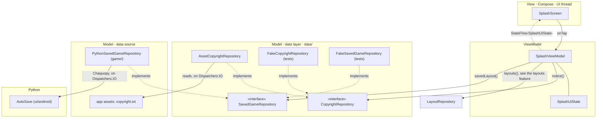

The notice's one copy is the repository's `ui/copyright.txt`: the build packages it as an asset
(`syncSharedAssets`), and the terminal reads it too.

| Layer | Class | What it does |
|---|---|---|
| View | `SplashScreen` | Stateless: the title at the top, the notice centred in the space below (a `Column` with a weighted `Box`); the whole screen reports a tap with `onTap` |
| ViewModel | `SplashViewModel` | Reads the notice from the `CopyrightRepository` and starts a 5-second timer, both in `viewModelScope`; `onTap()` ends the splash at once; its state lives in a `MutableStateFlow`; its `Factory` gets the repositories from the app's container. It also reads the layouts (which starts Python behind the splash) and the saved game's layout, and once the splash has ended and both are known, gives the route that replaces it: `Route.toStart(layouts, savedLayout)` (see `Route`), which it shares with the game screen's New puzzle: `Route.Game(layout)` for the saved game's layout when it can be picked, else for the only layout when there is exactly one and it can be picked, as the terminal plays it, otherwise `Route.LayoutPicker` |
| ViewModel | `SplashUiState` | The notice (empty until read), and `next`, the route that replaces the splash, null until the splash has ended and the layouts and the saved game are known |
| Data layer | `CopyrightRepository` | The interface: the one way to the GNU GPL notice, `suspend fun notice(): String` |
| Data layer | `AssetCopyrightRepository` | The real one: reads `copyright.txt` from the app's assets on `Dispatchers.IO`, and reflows it (`String.reflow()`): the file breaks its lines for the terminal, so each paragraph's lines are joined, for the screen to wrap to its own width |
| Data layer | `FakeCopyrightRepository` | A true fake for tests: returns the text it was given |
| Data layer | `SavedGameRepository` | The interface: the one way to what the auto-save holds before a game is started, `suspend fun savedLayout(): String?`, the name of the layout it is on, or null when there is none, or it can't be read (the game says why when it starts) |
| Data layer | `FakeSavedGameRepository` | A true fake for tests: returns the layout it was given |
| Data source | `PythonSavedGameRepository` | The real one: asks the Python `AutoSave` for the layout of the auto-save file, through Chaquopy, on `Dispatchers.IO` |
| Data source | app assets | `copyright.txt`, packaged from the repository's `ui/copyright.txt` by the build |
| Python | `AutoSave` | `ui/android/auto_save.py` (see the game feature): `saved_layout()` reads the file through `SaveFile` |

### From start through splash to game

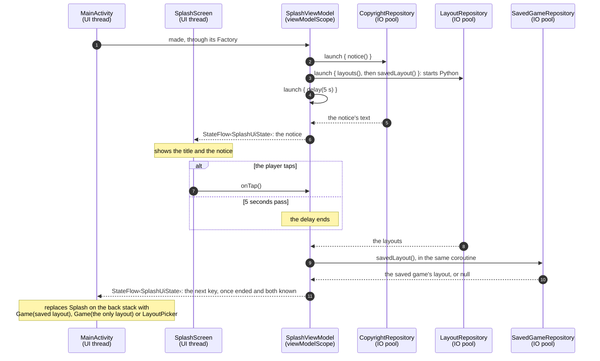

Python starts behind the splash: reading the layouts starts it, and its slow first start overlaps the 5 seconds.
The layouts and the saved game are read one after the other, in one coroutine, as both go through the one
Python. If the splash is tapped before they are known, it waits for them. The splash's ViewModel
lives only while `Splash` is on the back stack, so its timer ends with it.

## The layouts feature

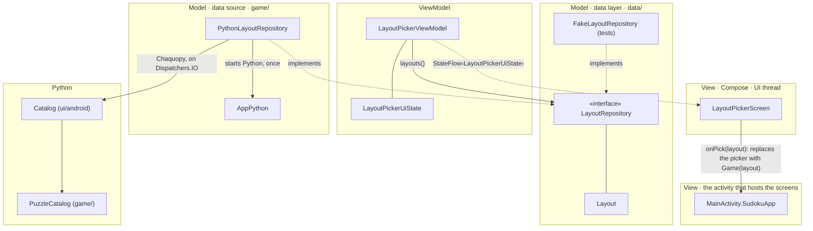

| Layer | Class | What it does |
|---|---|---|
| View | `LayoutPickerScreen` | Stateless: a Material 3 list of the layouts (`ListItem`s), each with its label; a broken one is shown, with its notes, but can't be picked. When none can be picked, it says so above the list, so the notes explain why; Back leaves the app. A pick goes up as `onPick(layout)`, which `SudokuApp` handles: picking is navigation, so it is the UI's to do, not the ViewModel's |
| ViewModel | `LayoutPickerViewModel` | Reads the layouts for the picker, in `viewModelScope`; its `Factory` gets the repository from the app's container |
| ViewModel | `LayoutPickerUiState` | The layouts (null until read), and `noneCanBePicked`: they are known and none can be picked, so the screen says so |
| Data layer | `Layout` | One layout: its `name`, its `label` (the name and any notes, as the terminal shows it), and whether it `canPick` |
| Data layer | `LayoutRepository` | The interface: the one way to the puzzle layouts, `suspend fun layouts(): List<Layout>` |
| Data layer | `FakeLayoutRepository` | A true fake for tests: returns the layouts it was given; a test can hold them back until it releases them, as a slow first start of Python would |
| Data source | `PythonLayoutRepository` | The real one: asks the Python `Catalog` for the layouts, through Chaquopy, on `Dispatchers.IO` |
| Data source | `AppPython` | Starts the app's one Python on first use, synchronized, for the layouts, the saved game and the game; slow the first time after an install |
| Python | `Catalog` | `ui/android/catalog.py`: lists the layouts in plain values, and makes the board of the one named; it plays the part `Main` plays for the terminal |
| Python | `PuzzleCatalog` | The game's catalog (`game/`): finds the layouts in `game/puzzles/` |

## The game feature

```mermaid
flowchart TB
    subgraph Host["View · the activity that hosts the screens"]
        direction LR
        SudokuApp["MainActivity.SudokuApp"]
        GameEntry["MainActivity's Game entry · LifecycleEventEffect(ON_STOP)"]
    end

    subgraph View["View · Compose · UI thread"]
        direction LR
        SudokuScreen["SudokuScreen · Scaffold"] --> GameContent["GameContent · BoxWithConstraints"]
        GameContent --> Board["Stacked, or SideBySide"]
        Board --> GameTopBar["GameTopBar · TopAppBar, overflow menu: New puzzle, How to play, About"]
        Board --> Controls["Controls: MessageArea, CommandPalette, DigitPad"]
        Controls --> CommandPalette["CommandPalette: ModeSwitch, CommandButton row, GuessToggle"]
        Controls --> DigitPad["DigitPad · the digits left"]
        Board --> GameColors["GameColors: the game's colors, light and dark"]
        SudokuScreen --> ConfirmDialog["ConfirmDialog"]
        SudokuScreen --> InformDialog["InformDialog"]
        SudokuScreen --> NewPuzzleDialog
    end

    subgraph ViewTests["View tests · androidTest · on the emulator"]
        direction LR
        SudokuScreenTest["SudokuScreenTest · createComposeRule"] --> RecordingIntents["RecordingIntents"]
    end

    subgraph VM["ViewModel"]
        direction LR
        SudokuViewModel --- SudokuUiState
    end

    subgraph DataLayer["Model · data layer · data/"]
        direction LR
        GameRepository["GameRepository"] --- GameState
        LayoutRepository["LayoutRepository, see the layouts feature"]
    end

    subgraph DataSource["Model · data source · game/"]
        direction LR
        PythonGame["PythonGame"] -. implements .-> Game["«interface» Game"]
        GameEvent
        FakeGame["FakeGame (tests)"] -. implements .-> Game
        PythonScreen
        GameNames["GameNames: GameAction, GameMode, Conflict"]
    end

    subgraph Python["Python · game thread"]
        direction LR
        AndroidUI["AndroidUI"] --> Puzzle["Puzzle, Board, Cell"]
        AndroidUI --> Requests["Request: Act, Save, Answer"]
        AndroidUI --> AutoSave["AutoSave"]
        AutoSave --> SaveFile["SaveFile (game/)"]
    end

    subgraph Storage["App storage · filesDir"]
        AutoSaveFile["autosave.json"]
    end

    GameEntry -- "onStopped()" --> SudokuViewModel
    GameEntry -- "onEnded(next): replaces the game" --> SudokuApp
    GameEntry -- "onHowToPlay, onAbout: pushes" --> SudokuApp
    SudokuScreenTest -- "setContent { SudokuScreen(state, intents) }" --> SudokuScreen
    SudokuScreen -- "intents" --> SudokuViewModel
    SudokuViewModel -. "StateFlow‹SudokuUiState›" .-> SudokuScreen
    SudokuViewModel -- "act(), answer(), save()" --> GameRepository
    SudokuViewModel -- "layouts(), for New puzzle" --> LayoutRepository
    GameRepository -. "StateFlow‹GameState›" .-> SudokuViewModel
    GameRepository -- "act(), answer(), save()" --> Game
    Game -. "Flow‹GameEvent›" .-> GameRepository
    PythonGame -- "Chaquopy" --> AndroidUI
    AndroidUI -. "showCell(), askConfirm(), showInform() …" .-> PythonScreen
    PythonScreen -. "GameEvent" .-> PythonGame
    PythonGame -- "Catalog.board(layout), see the layouts feature" --> AndroidUI
    SaveFile -- "writes, reads" --> AutoSaveFile

    classDef changed fill:#b45309,stroke:#fcd34d,stroke-width:2px,color:#ffffff
    class GameTopBar,SudokuScreen,GameEntry changed
```

Everything from `GameRepository` down is MVVM's **Model**, which Google's guide splits into the data layer and
its data sources. The Python game is at the bottom, as the source of truth for the puzzle.

| Layer | Class | What it does |
|---|---|---|
| View | `MainActivity`'s `Game` entry | Gets the ViewModel and shows the screen; calls `onStopped()` whenever the app is stopped, with `LifecycleEventEffect(Lifecycle.Event.ON_STOP)`, which runs only while the entry is on screen. Once the state has a `next` route, it gives it to `onEnded`, as the splash's entry does, and `SudokuApp` replaces the game with it |
| View | `SudokuScreen` | Stateless composables: draws the state, and passes taps on as intents (`SudokuIntents`). A Material 3 `Scaffold` pads `GameContent` clear of the system bars; the content places the top app bar itself, since where it goes depends on the space (see `GameContent`). Over them, the dialog the game is waiting on, the newest (`GameState.dialog`): `ConfirmDialog` for a question, `InformDialog` for a message; and New puzzle's. Each of the board's cells has a content description, "Row 3, column 8", which TalkBack reads, and the tests find the cell by |
| View | `GameContent` | Its `BoxWithConstraints` measures the space the screen is given. While the game is being played, and there is room beside a board as tall as the space for the `Controls` (`MIN_CONTROLS_WIDTH`, the pad's nine buttons), it shows them `SideBySide`; otherwise `Stacked`. It goes by the space, not by the device's orientation, as Google's adaptive guide asks: a split screen or a large screen can be wide in portrait |
| View | `Stacked` | A `Column`, the top app bar first, then the board, and the `Controls` at the bottom, within thumb reach. When the game has failed, or is starting, a `Notice` says so in place of the board and the controls. The board is as large as fits both ways: the `Controls` are measured first, and the board gets at most the rest (`weight(1f, fill = false)`), at its own ratio (`aspectRatio(cols / rows)`, which takes the largest size of that ratio within the constraints) |
| View | `SideBySide` | A `Row`: the board as tall as the space (`fillMaxHeight().aspectRatio(cols / rows, matchHeightConstraintsFirst = true)`), and beside it the top app bar and the `Controls`, so the board gets the rows a top app bar above it would take |
| View | `Controls` | What goes under or beside the board: the `MessageArea`, then the `CommandPalette`, then the `DigitPad` at the very bottom, where the thumb is |
| View | `CommandPalette` | The game-play buttons, in two rows: the `ModeSwitch`, and below it the command row, which MVP 2 adds Next, Auto, Why and Tag to. Like the rest of the screen, it shows the `SudokuUiState` and passes taps on as intents |
| View | `ModeSwitch` | A Material 3 segmented button (`SingleChoiceSegmentedButtonRow`), Setup \| Play, the component for picking one of a few options and showing which is picked. The selected segment is the mode the game last reported (`GameState.mode`), so the game stays the source of truth: a tap on the other segment is `onSwitchMode()`, and if the game refuses (Play with a conflict), the segment stays where it was |
| View | `CommandButton` | One command, its icon with its label below, as sudoku apps show their tools, all in one Material 3 `TextButton`, so the whole of it can be tapped, and the tests and TalkBack find it by its label (the icon has no description of its own); the icons are Material Symbols vector drawables in `res/drawable`, as the overflow button's is. The row has Undo (`undo`), Rewind (`fast_rewind`) and Erase (`ink_eraser`), then the `GuessToggle`. A command the mode doesn't offer is disabled (`enabled = false`, which TalkBack reads too), by `SudokuUiState.offers(action)`: Undo and Rewind in setup. "Nothing to undo" stays the game's own warning, as the game doesn't report whether there are moves |
| View | `GuessToggle` | The icon `question_mark` with the label Guess, laid out as the commands are, at the end of the command row; while it is on, it is filled with the color scheme's `secondaryContainer`. Material 3 has no toggle with a label below its icon, so it is a `Column` that is `toggleable` as a whole (`role = Role.Switch`), which TalkBack and the tests read as on or off. It plays the part of sudoku apps' Notes pencil: on, the pad enters guesses (`GUESS`); off, values (`VALUE`). It shows `SudokuUiState.guessing`, and a tap is `onGuessToggled()`. It is disabled, and shown off, while the mode doesn't offer `GUESS` |
| View | `GameColors` | `ui/theme/GameColors.kt`: the colors of the board and the messages, the terminal's, as they read on the theme's background (see The game's colors), as `GameColors.Light` and `GameColors.Dark`. It works out a cell's colors: `background(cell, related)`, the conflict's yellow, a given's lavender (dimmed in the dark theme, so it stands off the dark board as much as it does the light one, with a lighter purple on it), or the shade of its guess depth, with the highlight over it when the cell is related to the selected one; and `value(cell)`, by its kind, or the conflict's red. The guess shades, `GUESS_SHADES` of them (8), are the same number in both, in even steps away from the board's own color, the last repeated for any deeper guess; `AndroidUI` gets their number, to warn as the terminal does when guesses go past the last |
| View | `Board`, `Cell` | Each cell is drawn in `GameColors`' colors, with thin lines between the cells and thicker ones (`BLOCK_EDGE`) between the blocks; the selected cell has an outline in the color of what the pad enters (`SudokuUiState.entering`'s value color), inside its edges, and it and its related cells (`GameState.related`) the highlight, so a guess's shade still shows through it. A conflict's value is bold, as a given's is |
| View | `DigitPad` | The nine digits, a row of `FilledTonalButton`s, in the color of what they enter, as the selected cell's outline; a tap is `onDigit(digit)`. Each digit has the number of its places left (`SudokuUiState.left(digit)`) small below it, which TalkBack reads as "3 left" (the count's own content description, so it isn't a text a digit could be mistaken for). Once none are left, the digit is dimmed (to `DISABLED_ALPHA`, as a disabled button's content is) and the count is left out, but the button stays enabled, so the digit can still be entered, as a guess or to try it |
| View | `MessageArea` | The status message in a Material 3 tonal `Surface`, colored by its kind (as the terminal colors it, successes and hints in the solved value's blue, everything else in yellow, from `GameColors`), always three lines of text tall (the text style's line height, so it follows the player's font size), so neither a blank message nor a long one moves the pad. A longer message scrolls inside it (`verticalScroll(rememberScrollState())`), from its top for each new message |
| View | `GameTopBar` | A Material 3 `TopAppBar`, titled with the app's name (`R.string.app_name`, "Sudoku Solver", as on the splash and under the app's icon), whose one action is the overflow button (⋮, a Material Symbols vector drawable in `res/drawable`) opening a `DropdownMenu` with New puzzle, enabled once the game has started or failed. Whether the menu is open is kept in the composable (`remember`), as Google's guide on state hoisting allows for UI element state with no logic behind it; it closes on a rotation, as menus do. It is placed in the content, above the board or beside it, so it adds no window insets of its own (`windowInsets = WindowInsets(0.dp)`): the `Scaffold` has already padded the content clear of the system bars |
| View | `ConfirmDialog` | The game's yes/no question, an `AlertDialog` with Yes and No |
| View | `InformDialog` | An `AlertDialog` with the game's message and one button, OK. A warning is titled "Warning", and the text has its kind's color, as on the status line. Tapping outside the dialog, or Back, counts as OK, since the game only waits until the message has been seen |
| View | `NewPuzzleDialog` | An `AlertDialog`, "Start a new puzzle? The one in progress will be lost.", with Start new and Cancel; shown while `SudokuUiState.askingNewPuzzle` |
| ViewModel | `SudokuViewModel` | `uiState` combines `repository.state` with the screen's own state (whether New puzzle is asking, and the `next` route) into `SudokuUiState`, `.stateIn(viewModelScope, WhileSubscribed(5 s))`; each intent is `viewModelScope.launch { repository.act(...) }`; `onStopped()` asks the repository to save the game; `factory(layout)` gets the game on that layout, and the layouts' repository, from the app's container. `onNewPuzzle()` asks first when the board has values, else goes on at once; once the player goes on (`onNewPuzzleAnswer(true)`), it ends the game with `FORCE_QUIT` (unless the game has failed, when it has already ended), reads the layouts, waits for the game to end, and sets `next` to `Route.toStart(layouts)`: with the auto-save gone, that is the picker, or a new game on the only layout. `onInformed()` gives the game the player's OK, as `repository.answer(true)`. `onUndo()`, `onRewind()` and `onErase()` act `UNDO`, `REWIND` and `DEL`. Whether Guess is on is kept in a `MutableStateFlow`, combined into `uiState` with the rest: `onGuessToggled()` flips it, and `onDigit()` acts `GUESS` while `guessing`, else `VALUE`. It is one-shot, like Shift: a digit and every command (`command()`: Undo, Rewind, Erase, the mode switch, and New puzzle) turn it off, a tap on a cell doesn't; and as the ViewModel's, it stays on through a rotation. The digits left are derived from the state it already produces |
| ViewModel | `SudokuUiState` | The game's state, plus what the screen works out from it: the mode switch, `canStartNew` (the game has started or failed), `askingNewPuzzle`, and `next`, the route that replaces the game, null until a new puzzle has been asked for and the game has ended. `offers(action)`, whether the mode offers the action, for the commands' enabled state; and `guessOn` with `guessing`: Guess is on, and the mode offers `GUESS`. `entering`, the kind of value the pad enters: a given (`INITIAL`) in setup, a `GUESS` while guessing, else a `TYPED` value; the pad and the outline take its color. `left(digit)`, how many places the digit has left: one in each row of the board, less the cells holding it, whatever their kind or conflict, and never fewer than none. It is derived from `game.cells`, not kept, so it always matches the board |
| ViewModel | `SudokuIntents` | What the player can do on the screen: a tap on a cell or a digit, the commands, the Guess toggle, the mode switch, the dialogs' answers, and New puzzle |
| Data source | `GameAction`, `GameMode`, `Conflict` | `GameNames.kt`: the game's names, as Kotlin enums. `GameAction` is the game's actions the app uses: `FORCE_QUIT` stops the game at once, without the game's own "Really quit?". `GameMode` is the game's modes, `SETUP` and `PLAY` (`game/actions.py`'s `Mode`), which the mode switch picks its segment by. `Conflict`, a cell's conflict mark (`game/cell_attrs.py`): `CONFLICTING`, the value just entered clashes with a related cell, `CONFLICTED`, a value it clashes with, or `NONE` |
| Data layer | `GameRepository` | The one way to the game, in an app-long scope: `state = events.runningFold(GameState()) { s, e -> s.after(e) }.stateIn(scope, Eagerly)`; `act()` and `answer()` run on `Dispatchers.IO`, one at a time, so they keep their order. `save()` doesn't wait: it launches the save in the app-long scope, on the same one-at-a-time dispatcher, so it isn't canceled when Back clears the ViewModel right after `ON_STOP`, and it comes after the actions already made |
| Data layer | `GameState` | Only what the game reported; `after(event)` works out each event's effect; including `GameEvent.Failed`, which sets `failure`, the reason the game stopped. `failure` is kept apart from `isOver`, since the screen shows why the game failed, and New puzzle doesn't end a failed game again; `hasEnded` is either. `dialogs` are the dialogs the game is waiting on, a `GameDialog.Confirm(question)` or a `GameDialog.Inform(message)`, the newest last. `Asked` and `Informed` add one, and `Answered` takes the newest off. It is a list, not one dialog, because a dialog can open while another waits: a save that fails while a dialog waits warns in a dialog of its own, and once that is answered the screen shows the first again. `dialog` is the newest, or null. `mode` is a `GameMode`, null until the game reports one. `related`, the cells related to the selected one, as the game reported them with it |
| Data source | `Game` | The interface: `events: Flow<GameEvent>`, `act()`, `answer()`, `save()` |
| Data source | `GameEvent` | What the game reports (`Started`, `CellChanged`, `Over`, ...), with the related cells in `Selected` and a cell's `conflict` in its `CellState`, and `Failed(reason)`: the game has stopped on an error, while starting or later, and its flow ends. `Informed(message)`: the game shows the message, and waits until the player has seen it; `Answered` ends either kind of dialog. `ModeChanged` carries a `GameMode` |
| Data source | `PythonGame` | The real game, on the layout named, auto-saved to the file it is given, and told how many shades of gray the screen has for guesses, which it passes on to `AndroidUI`: `events = callbackFlow { ... }` starts the game thread, on the board from `Catalog.board(layout)` (with Python started by `AppPython`), and ends when the game is over; `act()` and `save()` call `AndroidUI` through Chaquopy. Any error that reaches it, in setting up or in play, is reported as `GameEvent.Failed`, so the app never waits on a game that can't start or no longer answers (an error in one of the player's actions doesn't reach it: `AndroidUI` catches that, and play goes on) |
| Data source | `PythonScreen` | What Python calls (`showCell()`, `askConfirm()`, `questionAnswered()`, ...), turned into `GameEvent`s. `showCell()` takes the cell's conflict by its game name, and `showSelected()` the related cells, as `[row, col]` pairs. `modeChanged()` maps the mode's name to a `GameMode`, as it maps the actions' names to `GameAction`s |
| Data source | `FakeGame` | A stand-in for tests: reports the events it is given, records the actions and the saves |
| View test | `SudokuScreenTest` | Compose UI tests of `SudokuScreen` (see Testing the screen), each showing the screen with a `SudokuUiState` it makes, and checking what the player sees and which intents a tap calls |
| View test | `RecordingIntents` | `SudokuIntents` that record each call, for the tests to check, as `FakeGame` records the actions |
| Python | `Screen` | `ui/android/screen.py`: the screen as `AndroidUI` sees it, which `PythonScreen` implements. `questionAnswered()` ends a `confirm()` or an `inform()`. `showCell()`'s `conflict` is a `CellAttrs` conflict mark, or "", and `showSelected()`'s `related` the related cells |
| Python | `AndroidUI` | The port's adapter (`ui/android/`); it shows a cell's conflict mark as it is, and the selected cell with its related cells (`game.related_cells()`): `act()` and `save()` → one requests queue → `play()`, so a save never lands in the middle of a move; an action goes to `puzzle.handle()`, a save to `AutoSave`. `play()` has `AutoSave` restore the game first, and forget it once the game is over; `confirm()` waits for `answer()`, then reports `questionAnswered()`. `inform()` does the same: it has the screen show the message (`showInform()`), waits for the OK, then reports `questionAnswered()`. A broken action is reported through `inform()`, as the terminal waits for a key, not on the status line. `answer()` puts an `Answer` on the one requests queue, and a dialog's wait takes requests off it, as `play()` does, until one ends it; the actions it holds are kept for `play()`, which carries them out first, in order. `play()` keeps the game it plays, so a wait can save it. `guess_depth_changed()` warns through `inform()` when guesses go from within the screen's shades of gray to deeper than the last, with the terminal's words, "No more shades of gray left - repeating last shade."; like any `inform()`, it waits for the OK |
| Python | `Request`, `Act`, `Save`, `Answer` | `ui/android/requests.py`, what the requests queue holds. Each says what it does in play (`in_play(game)`) and while a dialog waits (`while_waiting(game, held)`, which returns the answer once one ends the wait, else None). `Act` (the player's action) is carried out in play, and held while a dialog waits. `Save` is carried out at once either way, so a save at `ON_STOP` isn't lost behind an open dialog. `Answer(yes)` ends the wait with the player's answer; in play it is dropped, as no dialog waits for it (a second tap on OK). A new kind of request is a new class, with `play()` and the wait unchanged. Saving in a wait is safe because the game asks and informs only before or after a change to the puzzle, never in the middle of one |
| Python | `AutoSave` | `ui/android/auto_save.py`: the game in progress, in the file it is given, read and written through `SaveFile`. `restore()` restores the file's puzzle into the game, or warns why it can't (damaged, from a newer version, or on another layout) and leaves the file alone; `save()` writes the game when the board has values; `forget()` deletes the file once the game is over. A file it couldn't read is overwritten only once the player has something to save, and is never deleted, so the player can still install a newer version or keep the file |
| Python | `SaveFile` | The game's save files (`game/save_file.py`), the same format as on the PC |
| Python | `Puzzle`, `Board`, `Cell`, ... | The game itself (`game/`): the single source of truth for the puzzle; `saved_state()` and `restore()`. `Puzzle.related_cells(row, col)`, for user interfaces, the positions of the cells in the same block, row or column, which it asks the board for (`Board.related_cells()`), and the board the block of the cell, as only a block knows its cells |

### The game's colors

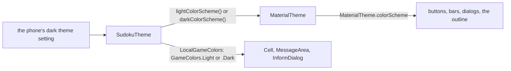

Material 3 names the colors every app has (`primary`, `surface`, `onSurface`, ...), and its components use them,
so a light and a dark scheme are all the buttons, bars and dialogs need. A game's own colors have no Material
names, so Google's guide has them in a class of their own, provided the same way, through a `CompositionLocal`:
a value the composition passes down to every composable inside it, without a parameter on each
([Custom design systems](https://developer.android.com/develop/ui/compose/designsystems/custom)).

The colors, and what they are in the terminal, are in `../CLAUDE.md`'s Design decisions (Colors). Each is chosen
so that it reads on everything it can be drawn on, which `GameColorsTest` checks:

- a value at least 3:1 against its background (WCAG's ratio for large text), with the highlight over it or not;
- the pad's digits, in each kind's color it enters, the same 3:1 against the pad's keys;
- the small possible values and the messages at least 4.5:1 (WCAG's ratio for body text).

### A tap on a cell, with its related cells

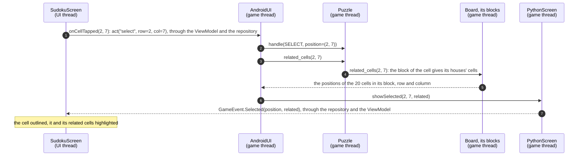

The related cells are the game's to say, as in other layouts a block need not be a regular 3x3 box.

### One tap, end to end: entering 5 in the selected cell

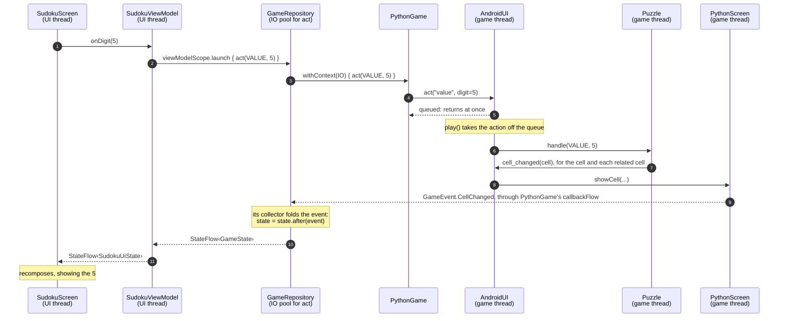

The intent and the result travel separate paths: `act()` returns as soon as the action is queued, and the 5
comes back later as events (unidirectional data flow). The UI thread never waits on Python.

### A guess: Guess on, then 5

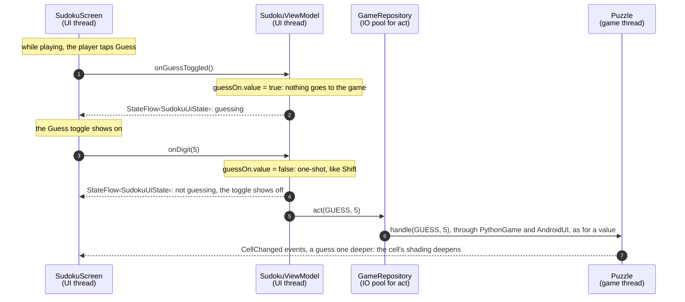

Whether Guess is on is the screen's own state, not the game's: the game has no such switch, only the two actions,
as the terminal has Shift. So it lives in the ViewModel, and the pad's digit picks the action by it.

Like Shift, it is one-shot: the next digit, or any command (Undo, Rewind, Erase, the mode switch, New puzzle),
turns it off. A tap on a cell doesn't, so the player can tap Guess, then the cell, then the digit.

### Rewind, and the game's question

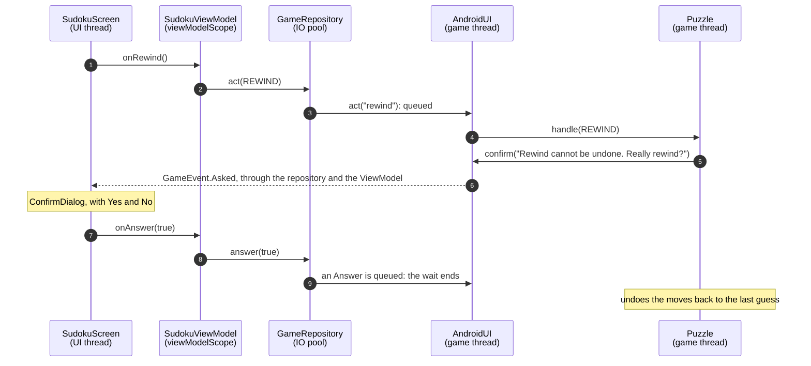

This is the first of the game's own questions the app can ask, so phase 8 also tried by hand what 7b covered
only in unit tests: a save while the question waits (Home, then process death), and coming back to it.

### A warning, as a dialog

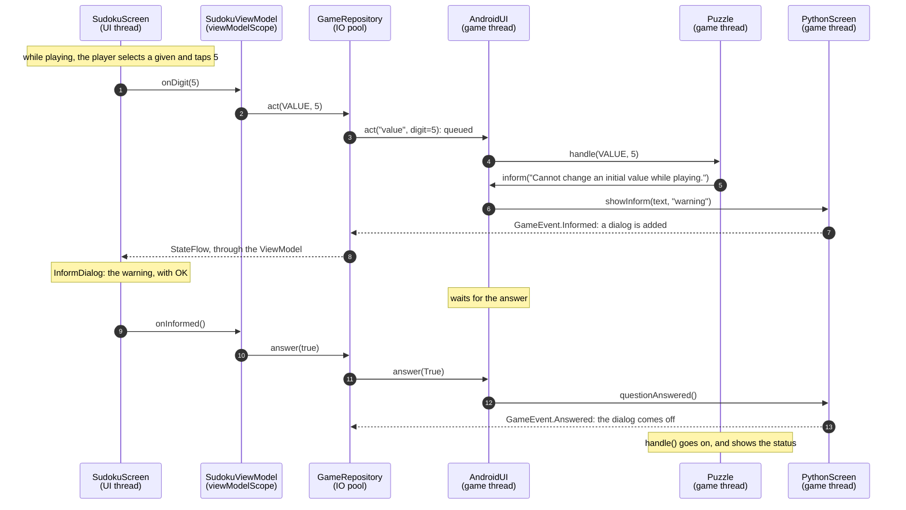

The dialog is the game's state, not the screen's: it is in `GameState` because the game is waiting on it. So a
rotation, or Back and coming back, shows it again, and the game goes on only once the player has seen it.

### Leaving the app while a dialog waits

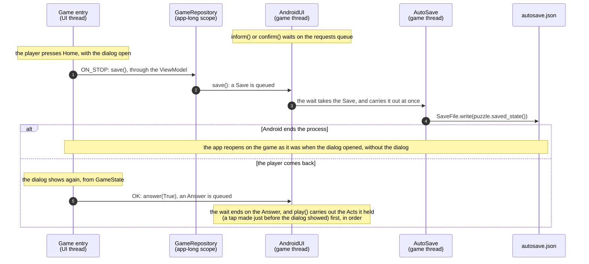

If the wait didn't carry out saves, the save would wait in the queue behind the dialog, and the moves since the
last save would be lost if Android ended the app first.

After process death, a warning is simply gone, as the move it refused was never made. A question, such as
"Really rewind?", is gone too, and the player asks again.

### Leaving the app, and coming back after process death

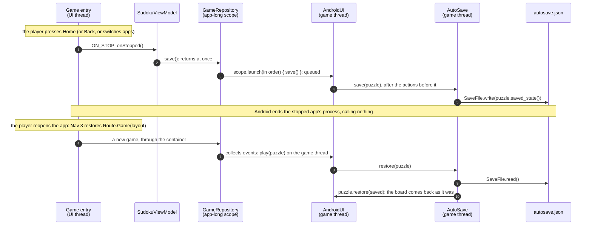

A fresh start of the app goes through the splash instead, which reads the saved game's layout and opens
`Route.Game` on it; from there the game restores itself the same way.

### New puzzle, from the menu

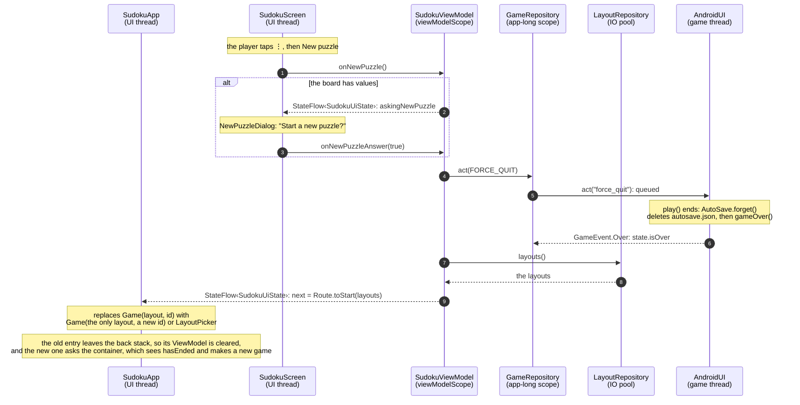

Cancel (`onNewPuzzleAnswer(false)`), or a tap outside the dialog, leaves the game as it was. When the game has
failed, New puzzle goes straight to the next route, as there is nothing left to lose or to end.

### When the game fails

For example, after process death the back stack reopens `Route.Game(layout)`, but that layout has since been
removed from `game/puzzles/`, or broken. Any other error that reaches `PythonGame`, while starting or later, goes
the same way.

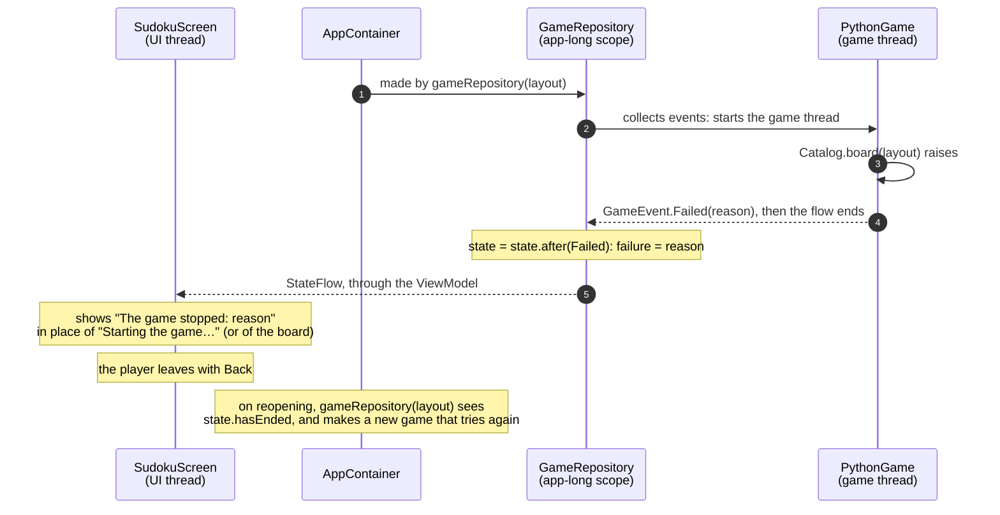

The cases, side by side:

| What happens | `GameState` | What the player sees |
|---|---|---|
| Python is still starting | `size` null, `failure` null | "Starting the game…" |
| An action fails (`AndroidUI` catches it, as the terminal does) | `dialog`, a warning | The board, with the warning in a dialog; play goes on after OK |
| The auto-save can't be restored (damaged, from a newer version, or on another layout) | `dialog`, a warning | A new board, with the warning in a dialog; the file is kept until the player has something to save |
| Anything else fails, while starting or later (`PythonGame` catches it) | `failure` set | "The game stopped: …" in place of the board; New puzzle starts again; Back leaves; reopening tries again |
| The player starts a new puzzle | `isOver` | The auto-save is deleted, then the layout picker, or a new game on the only layout |

### Testing the screen

The unit tests (`app/src/test`) cover each layer below the screen on the PC's JVM. The screen itself is covered
by Compose UI tests: instrumented tests (`app/src/androidTest`), which run on the emulator, as
the screen needs Android to draw. `gradle :app:connectedDebugAndroidTest` runs them, as does Android Studio's
gutter icon.

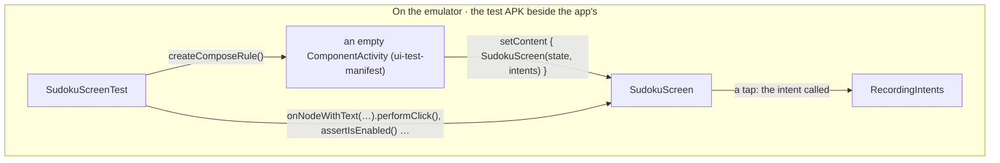

- **What a test is.** `createComposeRule()` shows the composable alone, in an empty activity, without
  `MainActivity`, a ViewModel or Python. Since `SudokuScreen` is stateless, the test gives it the state it wants
  (a `SudokuUiState` it makes) and checks what is shown, and which intents a tap calls.

- **How it finds things: the semantics tree.** Compose describes the screen to TalkBack as a tree of nodes, each
  with its text, content description and state (enabled, selected, toggled). The tests find nodes the same way,
  by what the player sees (`onNodeWithText("Undo")`), act on them (`performClick()`) and check their state
  (`assertIsNotEnabled()`, `assertIsSelected()`, `assertIsOn()`). So a button a test can't find by its label is
  one TalkBack can't read either.

- **What it adds to the build.** `ui-test-junit4` (`androidTestImplementation`, its version from the Compose BOM),
  `ui-test-manifest` (`debugImplementation`: the empty activity), and `testInstrumentationRunner`
  (`AndroidJUnitRunner`) in `defaultConfig`.

  Also `espresso-core` 3.7.0, which the Compose tests send taps through: the older one `ui-test-junit4` brings
  calls `InputManager.getInstance()`, which Android 17 no longer has, so every tap failed.

  The test APK runs in the app's process, so `SudokuApplication` is made
  as usual, but its container makes nothing until asked, so Python doesn't start.

- **What they test.** A tap on a cell or a digit, and the dialogs' buttons (Yes, No, OK, Start new). A cell has no
  text of its own to be found by, so each cell has a content description, "Row 3, column 8", which TalkBack reads
  too. The mode switch's selected segment and its tap; Undo, Rewind and Erase, and the commands disabled in setup;
  the Guess toggle, on, off, and disabled in setup.

  Phase 9 adds the pad's counts, found by their content description ("3 left"), and a digit with none left,
  still enabled and entered on a tap. The dimming isn't in the semantics tree, so it is checked by eye.

  Step 10c adds the menu's How to play and About, which go up as navigation, not as intents, and
  `PushedScreensTest`: How to play's headings, About's version and notice, and Up, found by its content
  description ("Navigate up"), on each.

Google's guide: [Test your Compose layout](https://developer.android.com/develop/ui/compose/testing).

## How to play and About

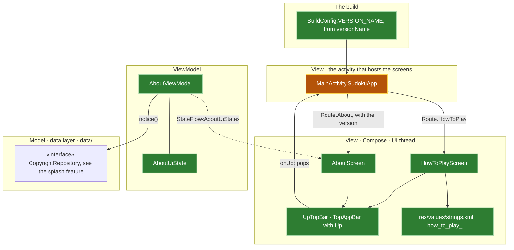

| Layer | Class | What it does |
|---|---|---|
| View | `MainActivity.SudokuApp` | Pushes `Route.HowToPlay` or `Route.About` (`backStack.add()`) when the game's menu asks for it, and pops it (`removeLastOrNull()`) on Up, as `NavDisplay` does on Back. The game's entry stays on the stack below, with its ViewModel, so the game is as it was when the player comes back. Nothing in the game can change while it is covered, so the save made when the app is stopped is current, even while the game is covered |
| View | `UpTopBar` | The top app bar of a pushed screen: its title, and Up (←, Material Symbols' `arrow_back`, described as "Navigate up" for TalkBack), which calls `onUp`. It sits in its screen's `Scaffold` as the top bar, so it pads itself clear of the status bar |
| View | `HowToPlayScreen` | Stateless: How to play's paragraphs, from string resources, in a scrolling column. It has no ViewModel, as it has no state and no data |
| View | `AboutScreen` | Stateless: the app's name and version, and the GNU GPL notice below, scrolling |
| ViewModel | `AboutViewModel` | Reads the notice from the `CopyrightRepository`, in `viewModelScope`, as the splash does; its `Factory` gets the repository from the app's container |
| ViewModel | `AboutUiState` | The notice, empty until read |
| Build | `BuildConfig.VERSION_NAME` | The app's version, `versionName` in `app/build.gradle.kts` (1.0 for MVP 1), which the build writes into the generated `BuildConfig` class (`buildFeatures { buildConfig = true }`). It is fixed when the app is built, so `SudokuApp` gives it to `AboutScreen` as it is, not through a repository |

How to play is the app's own text, written for touch, so it lives in the app's string resources; the terminal's
help (`?`) is about keys. MVP 2 adds the game's help for its solving commands.

### Opening About, and coming back

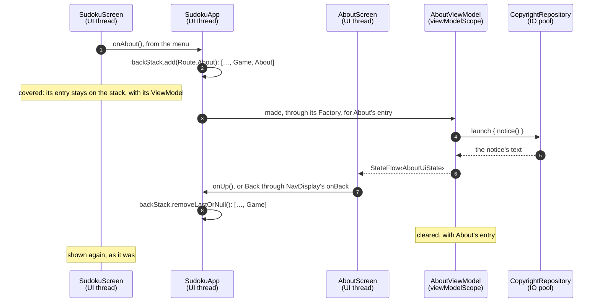

## Building and installing

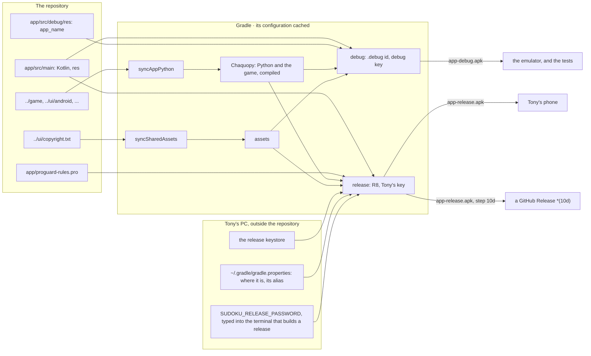

- **Build types.** Each build is of a build type, which says how the same sources are built
  ([Configure build variants](https://developer.android.com/build/build-variants)). `debug` is for the emulator
  and the tests: debuggable, signed with the debug key Android Studio makes on each PC, and measured by JaCoCo.
  `release` is the app as it is played: optimized, and signed with Tony's own key.

  Changed: the debug build's application id ends in `.debug` (`applicationIdSuffix`), so Android sees it as
  another app: both can be installed side by side, each with its own storage, and so its own saved game. Its name
  is "Sudoku Solver (debug)", from `app/src/debug/res/values/strings.xml`, which overrides `app_name` for debug
  builds only, as a build type's own source set does.

- **Signing.** Android installs only signed APKs, and lets a new version replace the one installed only when
  both are signed with the same key ([Sign your app](https://developer.android.com/studio/publish/app-signing)).
  So the release keystore is the app's identity: it is kept outside the repository and backed up, and if it is
  lost, a new key can only be installed after the old app (and its saved game) is uninstalled.

  The build finds the keystore and its alias in Tony's own `~/.gradle/gradle.properties`, never in the
  repository. The password is never on disk: it is typed into the terminal that builds a release, which keeps it
  in its environment until it is closed, and the build reads it from there, only when it is asked for a release
  (`buildsRelease`). Android Studio's builds don't have it, so a release is built from the terminal:

  ```powershell
  $env:SUDOKU_RELEASE_PASSWORD = Read-Host "Keystore password" -MaskInput
  .\gradlew.bat :app:installRelease
  ```

  Without them (a clone on another PC, or Android Studio) the release build is made, unsigned, as
  `app-release-unsigned.apk`, and there is no `installRelease`.

- **R8** shrinks and optimizes the release build: it removes the code nothing calls, and renames the rest
  ([Enable app optimization](https://developer.android.com/topic/performance/app-optimization/enable-app-optimization)).
  Compose runs much faster optimized than in a debug build, which also checks every recomposition's work.

  R8 sees only calls in Kotlin and Java. Python calls `PythonScreen`'s methods by name, through Chaquopy, so
  `proguard-rules.pro` keeps them as they are. Chaquopy brings its own rules for its own classes.

- **Gradle's configuration cache**
  ([Configuration cache](https://docs.gradle.org/current/userguide/configuration_cache.html)). Each build first
  configures itself: it runs the build scripts and works out the graph of tasks to run. With the cache
  (`org.gradle.configuration-cache=true`, in `gradle.properties`), Gradle keeps the result, and reuses it until a
  build script, a property or a file the scripts read changes.

  For that, a task may not reach back into the build's configuration while it runs: `syncSharedAssets` declares
  its inputs and output, `syncAppPython` is Gradle's own `Sync`, and Chaquopy 17.2.0's tasks pass too.

  The cache would keep the release key's password, as one of the build's inputs, so a build asked for a release
  isn't cached: it marks `packageRelease` `notCompatibleWithConfigurationCache()`, and Gradle then doesn't store
  the build's configuration.

- **The launcher icon,** an adaptive icon
  ([Adaptive icons](https://developer.android.com/develop/ui/views/launch/icon_design_adaptive)): a
  foreground and a background vector drawable, which the phone crops to its own shape and may move a little, and a
  monochrome one for themed icons (Android 13 and later). `res/drawable-v26/ic_launcher.xml` puts them together,
  and the manifest names it (`android:icon`); before Android 8, `res/drawable/ic_launcher.xml` shows the same
  layers, uncropped. They are in `drawable`, not `mipmap`, as mipmaps are for bitmaps kept at every density, and
  these are vectors. The foreground is a 3x3 grid with a given's digit, in its purple on
  lavender, with SOLVED across it, in the solved value's blue, on a band of lavender that keeps the grid's lines off it. The themed icon is the grid alone, as
  the stamp can't be read in one color.

- **Installing.** `gradle :app:installRelease` builds `app/build/outputs/apk/release/app-release.apk` and
  installs it on every device connected over USB with USB debugging on (Developer options), the emulator too.
  `assembleRelease` only builds it.

  An app already installed under the same id but signed with another key (such as a debug build from before
  `.debug`) must be uninstalled first: Android refuses the update (`INSTALL_FAILED_UPDATE_INCOMPATIBLE`).

  Each new version needs a higher `versionCode`, or Android refuses to replace the one installed; `versionName` is
  what Settings shows.
