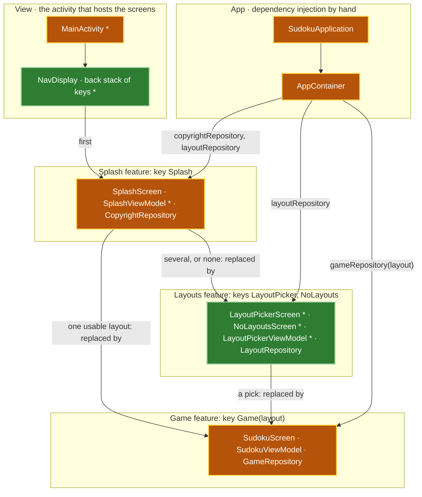
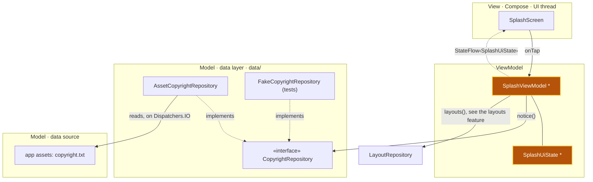
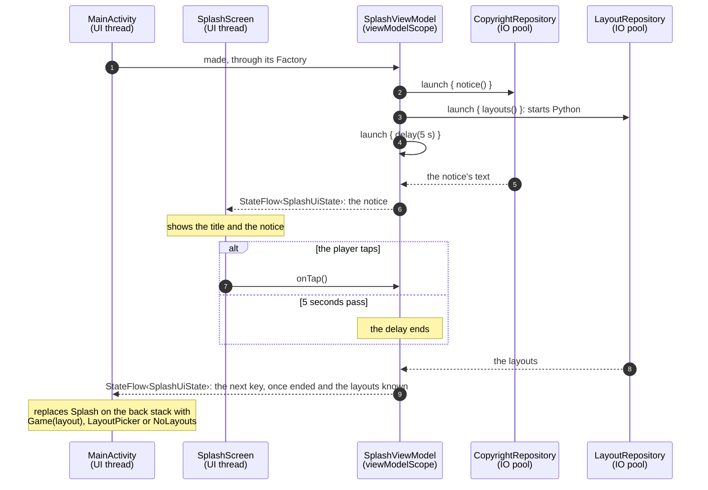
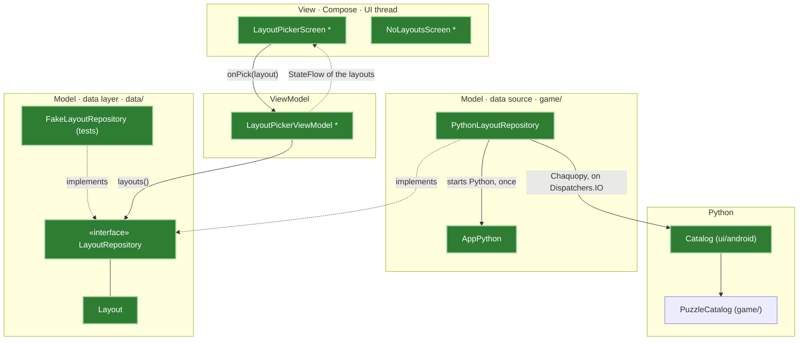
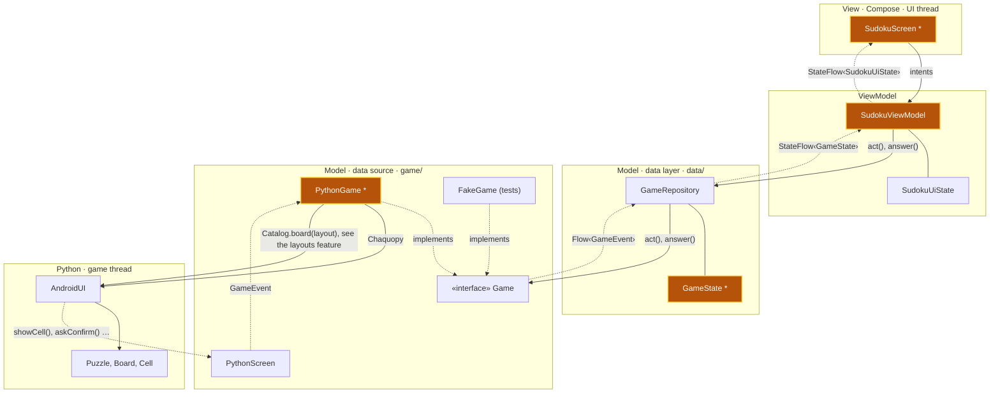
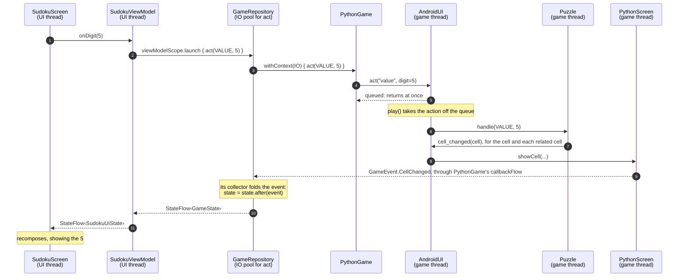

# The Android app's architecture

How the app's code maps onto MVVM and Modern Android App Architecture, and how the parts talk to each other.
Updated at the start of each phase and as it goes; this is **MVP 1, phase 4** (Navigation 3), while it is being
built. The parts marked * are planned in this phase but not written yet.

The app is drawn as an overview, then one section per feature (a screen with its ViewModel and data), each
through the same layers. Features share only the app's container and the activity that hosts their screens.

Colors: green is new in phase 4, amber is changed in phase 4, uncolored is unchanged.

Arrows: solid arrows are calls; dotted arrows are data flowing back, or a class implementing an interface.

## Overview

| Class | What it does |
|---|---|
| `SudokuApplication` | Made by Android once per process, before any screen (the manifest names it); makes the one `AppContainer`, giving it `newGame` (a `PythonGame` on the layout named), `newLayoutRepository` and `newCopyrightRepository` |
| `AppContainer` | The app's dependencies (`DefaultAppContainer`): the app-long scope; `gameRepository(layout)`, the game in play, made when first asked for and anew for another layout or once the game is over; and the `LayoutRepository` and `CopyrightRepository`, each made when first asked for |
| `MainActivity` | Its composable `SudokuApp` holds the back stack (`rememberNavBackStack`, kept through rotation and process death) and shows it with `NavDisplay`, each screen with its own ViewModels; * today it still shows the splash, then the game on the standard layout (`STANDARD_LAYOUT`, until navigation replaces it) |
| Keys * | `Splash`, `LayoutPicker`, `NoLayouts` and `Game(layout)`: `@Serializable` `NavKey`s, one per screen; each step replaces the key before it, so Back from the game leaves the app |

## The splash feature

The notice's one copy is the repository's `ui/copyright.txt`: the build packages it as an asset
(`syncSharedAssets`), and the terminal reads it too.

| Layer | Class | What it does |
|---|---|---|
| View | `SplashScreen` | Stateless: the title at the top, the notice centred in the space below (a `Column` with a weighted `Box`); the whole screen reports a tap with `onTap` |
| ViewModel | `SplashViewModel` | Reads the notice from the `CopyrightRepository` and starts a 5-second timer, both in `viewModelScope`; `onTap()` ends the splash at once; its state lives in a `MutableStateFlow`; its `Factory` gets the repository from the app's container. * It also reads the layouts (which starts Python behind the splash), and once the splash has ended and the layouts are known, gives the key that replaces it |
| ViewModel | `SplashUiState` | The notice (empty until read), and whether the splash has ended (`hasEnded`); * and the key that comes next, once known |
| Data layer | `CopyrightRepository` | The interface: the one way to the GNU GPL notice, `suspend fun notice(): String` |
| Data layer | `AssetCopyrightRepository` | The real one: reads `copyright.txt` from the app's assets on `Dispatchers.IO`, and reflows it (`String.reflow()`): the file breaks its lines for the terminal, so each paragraph's lines are joined, for the screen to wrap to its own width |
| Data layer | `FakeCopyrightRepository` | A true fake for tests: returns the text it was given |
| Data source | app assets | `copyright.txt`, packaged from the repository's `ui/copyright.txt` by the build |

### From start through splash to game *

Python starts behind the splash: reading the layouts starts it, and its slow first start overlaps the 5 seconds.
If the splash is tapped before the layouts are known, it waits for them.

## The layouts feature

| Layer | Class | What it does |
|---|---|---|
| View | `LayoutPickerScreen` * | A Material list of the layouts, each with its label; a broken one is shown, with its notes, but can't be picked |
| View | `NoLayoutsScreen` * | Shown when no layout can be picked: says so, and lists each layout's notes; Back leaves the app |
| ViewModel | `LayoutPickerViewModel` * | Reads the layouts for the picker; `onPick(layout)` replaces the picker with `Game(layout)` |
| Data layer | `Layout` | One layout: its `name`, its `label` (the name and any notes, as the terminal shows it), and whether it `canPick` |
| Data layer | `LayoutRepository` | The interface: the one way to the puzzle layouts, `suspend fun layouts(): List<Layout>` |
| Data layer | `FakeLayoutRepository` | A true fake for tests: returns the layouts it was given |
| Data source | `PythonLayoutRepository` | The real one: asks the Python `Catalog` for the layouts, through Chaquopy, on `Dispatchers.IO` |
| Data source | `AppPython` | Starts the app's one Python on first use, synchronized, for both the layouts and the game; slow the first time after an install |
| Python | `Catalog` | `ui/android/catalog.py`: lists the layouts in plain values, and makes the board of the one named; it plays the part `Main` plays for the terminal |
| Python | `PuzzleCatalog` | The game's catalog (`game/`): finds the layouts in `game/puzzles/` |

## The game feature

Everything from `GameRepository` down is MVVM's **Model**, which Google's guide splits into the data layer and
its data sources. The Python game is at the bottom, as the source of truth for the puzzle.

| Layer | Class | What it does |
|---|---|---|
| View | `SudokuScreen` | Stateless composables: draws the state, and passes taps on as intents (`SudokuIntents`); * shows why the game couldn't start, in place of "Starting the game…", when it failed |
| ViewModel | `SudokuViewModel` | `uiState = repository.state.map { SudokuUiState(it) }.stateIn(viewModelScope, WhileSubscribed(5 s))`; each intent is `viewModelScope.launch { repository.act(...) }`; `factory(layout)` gets the game on that layout from the app's container |
| ViewModel | `SudokuUiState` | The game's state, plus what the screen works out from it (the mode switch) |
| Data layer | `GameRepository` | The one way to the game, in an app-long scope: `state = events.runningFold(GameState()) { s, e -> s.after(e) }.stateIn(scope, Eagerly)`; `act()` and `answer()` run on `Dispatchers.IO`, one at a time, so they keep their order |
| Data layer | `GameState` | Only what the game reported; `after(event)` works out each event's effect; * including `GameEvent.Failed`, the reason the game couldn't start |
| Data source | `Game` | The interface: `events: Flow<GameEvent>`, `act()`, `answer()` |
| Data source | `PythonGame` | The real game, on the layout named: `events = callbackFlow { ... }` starts the game thread, on the board from `Catalog.board(layout)` (with Python started by `AppPython`), and ends when the game is over; `act()` calls `AndroidUI.act()` through Chaquopy. * Setting up and playing are caught separately: a setup failure reports `GameEvent.Failed`, so the app never waits on a game that can't start; a failure in play stays a status warning |
| Data source | `PythonScreen` | What Python calls (`showCell()`, `askConfirm()`, `questionAnswered()`, ...), turned into `GameEvent`s |
| Data source | `FakeGame` | A stand-in for tests: reports the events it is given, records the actions |
| Python | `AndroidUI` | The port's adapter (`ui/android/`): `act()` → actions queue → `play()` → `puzzle.handle()`; `confirm()` waits for `answer()` |
| Python | `Puzzle`, `Board`, `Cell`, ... | The game itself (`game/`): the single source of truth for the puzzle |

### One tap, end to end: entering 5 in the selected cell

The intent and the result travel separate paths: `act()` returns as soon as the action is queued, and the 5
comes back later as events (unidirectional data flow). The UI thread never waits on Python.
