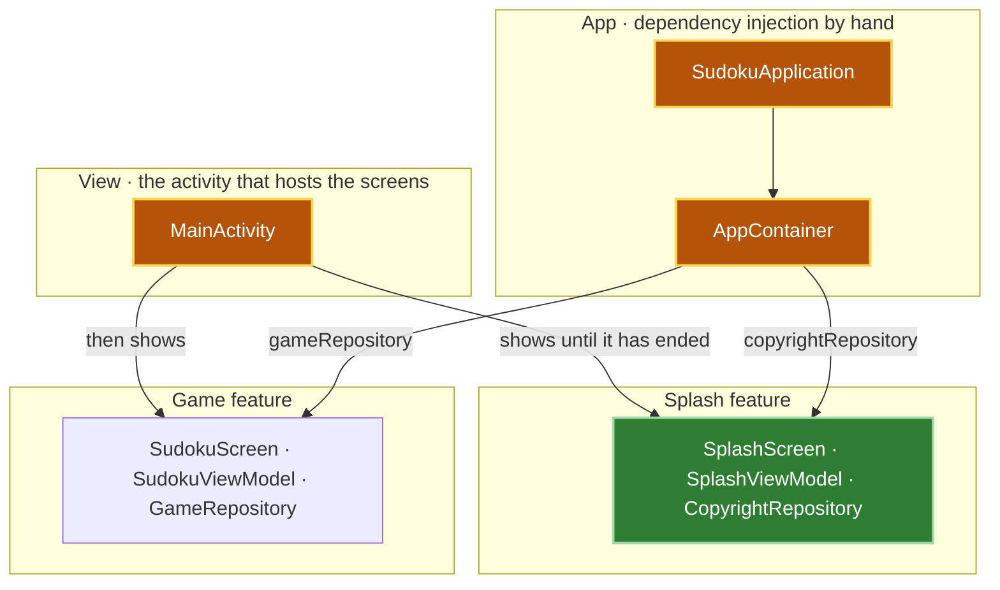
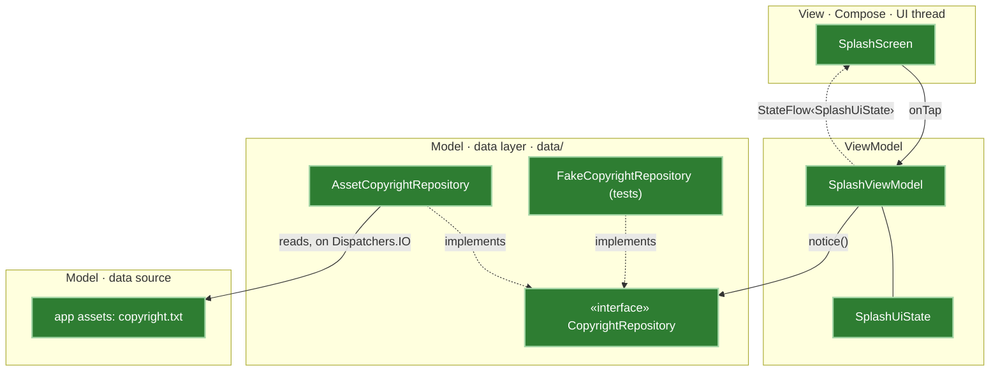
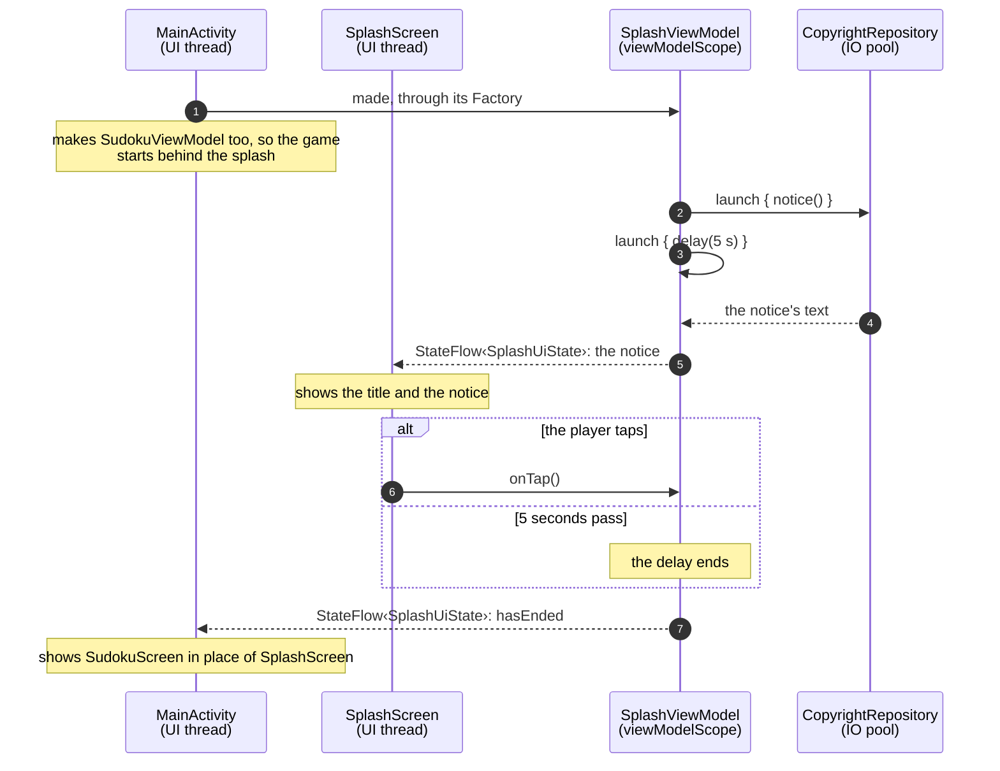
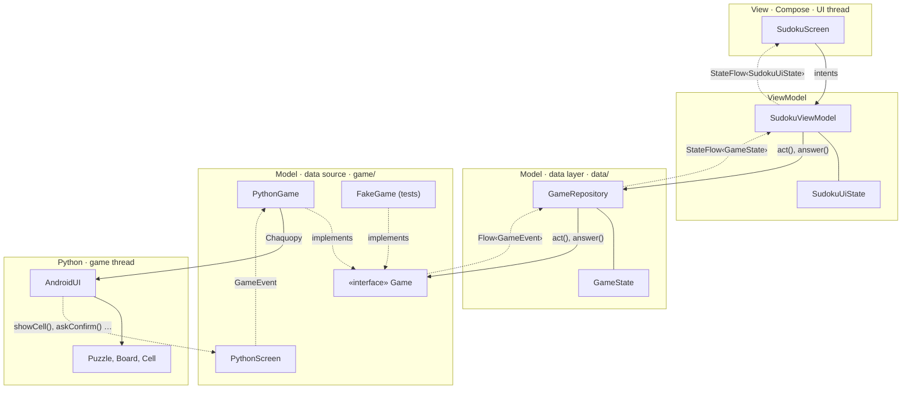
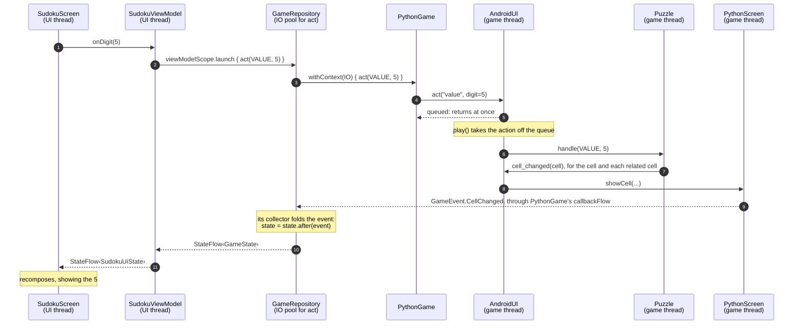

# The Android app's architecture

How the app's code maps onto MVVM and Modern Android App Architecture, and how the parts talk to each other.
Updated at the end of each phase; this is the state after **MVP 1, phase 3** (the splash screen).

The app is drawn as an overview, then one section per feature (a screen with its ViewModel and data), each
through the same layers. Features share only the app's container and the activity that hosts their screens.

Colors: green is new in phase 3, amber is changed in phase 3, uncolored is unchanged.

Arrows: solid arrows are calls; dotted arrows are data flowing back, or a class implementing an interface.

## Overview

| Class | What it does |
|---|---|
| `SudokuApplication` | Made by Android once per process, before any screen (the manifest names it); makes the one `AppContainer`, giving it `newGame` and `newCopyrightRepository` |
| `AppContainer` | The app's dependencies (`DefaultAppContainer`): the app-long scope; the `GameRepository` of the game in play, made when first asked for and anew once the game is over; and the `CopyrightRepository`, made when first asked for |
| `MainActivity` | Makes the features' ViewModels, through their factories, and collects their state with `collectAsStateWithLifecycle()`, in its composable `SudokuApp`; shows the splash until it has ended, then the game; closes once the game is over. It makes the game's ViewModel at once, not after the splash, so the game, and Python's slow first start, get going behind the splash |

## The splash feature

The notice's one copy is the repository's `ui/copyright.txt`: the build packages it as an asset
(`syncSharedAssets`), and the terminal reads it too.

| Layer | Class | What it does |
|---|---|---|
| View | `SplashScreen` | Stateless: the title at the top, the notice centred in the space below (a `Column` with a weighted `Box`); the whole screen reports a tap with `onTap` |
| ViewModel | `SplashViewModel` | Reads the notice from the `CopyrightRepository` and starts a 5-second timer, both in `viewModelScope`; `onTap()` ends the splash at once; its state lives in a `MutableStateFlow`; its `Factory` gets the repository from the app's container |
| ViewModel | `SplashUiState` | The notice (empty until read), and whether the splash has ended (`hasEnded`) |
| Data layer | `CopyrightRepository` | The interface: the one way to the GNU GPL notice, `suspend fun notice(): String` |
| Data layer | `AssetCopyrightRepository` | The real one: reads `copyright.txt` from the app's assets on `Dispatchers.IO`, turning Windows line endings into `\n` |
| Data layer | `FakeCopyrightRepository` | A true fake for tests: returns the text it was given |
| Data source | app assets | `copyright.txt`, packaged from the repository's `ui/copyright.txt` by the build |

### From start through splash to game

The Python game starts behind the splash: `SudokuApp` makes the game's ViewModel along with the splash's, which
asks the container for the game's repository and so starts Python, and its slow first start overlaps the 5
seconds.

## The game feature

Everything from `GameRepository` down is MVVM's **Model**, which Google's guide splits into the data layer and
its data sources. The Python game is at the bottom, as the source of truth for the puzzle.

| Layer | Class | What it does |
|---|---|---|
| View | `SudokuScreen` | Stateless composables: draws the state, and passes taps on as intents (`SudokuIntents`) |
| ViewModel | `SudokuViewModel` | `uiState = repository.state.map { SudokuUiState(it) }.stateIn(viewModelScope, WhileSubscribed(5 s))`; each intent is `viewModelScope.launch { repository.act(...) }`; its `Factory` gets the repository from the app's container |
| ViewModel | `SudokuUiState` | The game's state, plus what the screen works out from it (the mode switch) |
| Data layer | `GameRepository` | The one way to the game, in an app-long scope: `state = events.runningFold(GameState()) { s, e -> s.after(e) }.stateIn(scope, Eagerly)`; `act()` and `answer()` run on `Dispatchers.IO`, one at a time, so they keep their order |
| Data layer | `GameState` | Only what the game reported; `after(event)` works out each event's effect |
| Data source | `Game` | The interface: `events: Flow<GameEvent>`, `act()`, `answer()` |
| Data source | `PythonGame` | The real game: `events = callbackFlow { ... }` starts the game thread, and ends when the game is over; `act()` calls `AndroidUI.act()` through Chaquopy |
| Data source | `PythonScreen` | What Python calls (`showCell()`, `askConfirm()`, `questionAnswered()`, ...), turned into `GameEvent`s |
| Data source | `FakeGame` | A stand-in for tests: reports the events it is given, records the actions |
| Python | `AndroidUI` | The port's adapter (`ui/android/`): `act()` → actions queue → `play()` → `puzzle.handle()`; `confirm()` waits for `answer()` |
| Python | `Puzzle`, `Board`, `Cell`, ... | The game itself (`game/`): the single source of truth for the puzzle |

### One tap, end to end: entering 5 in the selected cell

The intent and the result travel separate paths: `act()` returns as soon as the action is queued, and the 5
comes back later as events (unidirectional data flow). The UI thread never waits on Python.
